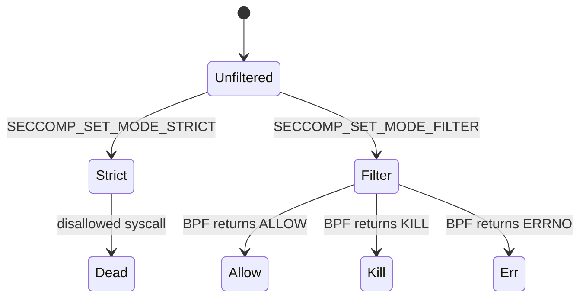
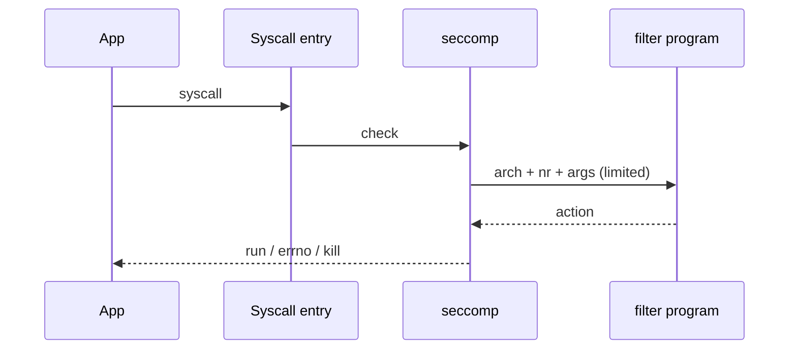

**seccomp** restricts which syscalls a process may make. Classic mode kills on anything but a tiny allowlist; **seccomp-BPF** attaches a BPF program that decides allow / errno / trap / kill per syscall.

## Modes



## Filter path



Containers and browsers stack seccomp with namespaces and capabilities. Filters are usually **inherited** across `fork`/`exec` unless carefully reset.

## Source landmarks

| Piece | Where |
| --- | --- |
| Core | `kernel/seccomp.c` |
| UAPI | `include/uapi/linux/seccomp.h` |
| Lib | libseccomp |
| Docs | `Documentation/userspace-api/seccomp_filter.rst` |

## Lab — See seccomp mode

<div class="lab">

### Lab — Read Seccomp field

```bash
grep Seccomp /proc/$$/status
# 0 = disabled, 1 = strict, 2 = filter (typical)
```

**Expect:** `Seccomp: 0` in an ordinary shell; non-zero inside many containers or sandboxed apps.

</div>

## Keep reading

- [Capabilities and LSM intro](/linternals/blog/capabilities-and-lsm-intro/)
- [Syscalls: crossing the boundary](/linternals/blog/syscalls-crossing-the-boundary/)
- [BPF and tracing intro](/linternals/blog/bpf-and-tracing-intro/)
