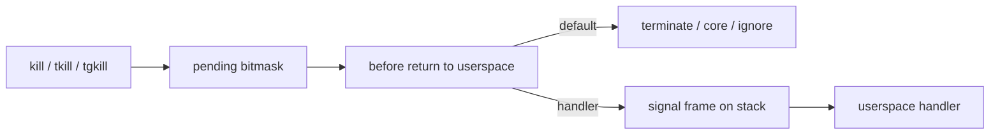
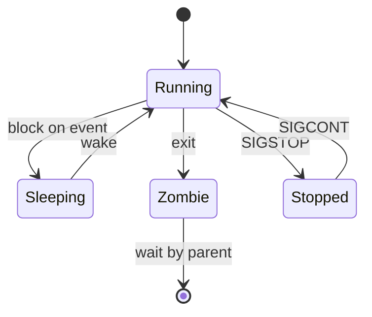

Signals are asynchronous notifications to a task: terminate, stop, dump core, ignore, or run a userspace **handler**. They sit between “pure synchronous syscalls” and “hardware interrupts” — generated by other processes, the kernel (e.g. `SIGSEGV`, `SIGCHLD`), or the task itself (`raise`).

## Why signals matter

Job control (`Ctrl-Z`, `fg`), shells waiting on children, graceful shutdown (`SIGTERM` then `SIGKILL`), and crash reporting all ride this path. If you only know `kill -9`, you miss how handlers, masks, and stopped states interact with the scheduler and `wait`.

## Delivery sketch



Delivery is usually **deferred** until the task is about to return to userspace (or is interrupted in an interruptible sleep). That keeps kernel critical sections saner: you do not randomly jump into a handler from deep inside `copy_to_user` without careful setup.

Rough path for `kill(2)`:

1. Find the target `task_struct` / thread group (permission checks: same uid, `CAP_KILL`, etc.).
2. Set a bit in the pending set (shared and/or per-thread, depending on signal).
3. Wake the task if it was blocked in a way signals can interrupt.
4. On the receiver side, exit-to-userspace code notices pending work, builds a **signal frame**, and rearranges user registers so execution resumes in the handler (or terminates).

## Default actions vs handlers

| Disposition | Typical signals | Effect |
| --- | --- | --- |
| Terminate | `SIGTERM`, `SIGINT` | Process exits |
| Core dump | `SIGQUIT`, `SIGSEGV`, `SIGABRT` | Dump + exit (policy permitting) |
| Stop | `SIGSTOP`, `SIGTSTP` | Task stops (job control) |
| Continue | `SIGCONT` | Wake from stopped |
| Ignore | `SIGCHLD` (often) | No visible action |
| Handler | anything catchable | Run `sa_handler` / `sa_sigaction` |

`SIGKILL` and `SIGSTOP` cannot be caught or ignored — by design, so admins and parents retain control.

`sigaction` is the modern API: masks during handler execution, `SA_RESTART`, `SA_SIGINFO`, alternate stacks (`sigaltstack`) for recovering from stack overflow faults.

## Lifecycle reminder



- **Zombie**: task has exited; `task_struct` lingers until a parent `wait*` reaps exit status. Signal path: child exit queues `SIGCHLD` to the parent (unless ignored / `SA_NOCLDWAIT` style behavior).
- **Stopped**: still exists, not on a runqueue in the normal sense until `SIGCONT`.
- **Orphans**: if the parent dies, `init` (or a subreaper) adopts children and reaps them.

## Thread groups

In Linux, “process” for signals often means a **thread group**. `kill` targets the group; `tgkill` / `pthread_kill` target a specific TID. Some signals are process-directed (any thread may take them); others are thread-directed. Mixing these up shows up as “I sent SIGTERM but the wrong thread died” bugs in multithreaded servers.

## Source landmarks

| Piece | Where |
| --- | --- |
| Core | `kernel/signal.c` |
| UAPI | `include/uapi/asm-generic/signal.h` |
| Man | `signal(7)`, `sigaction(2)`, `kill(2)` |

## Lab — Pending and dispositions

<div class="lab">

### Lab — Inspect signal state

```bash
# Disposition / pending masks for this shell
grep -E 'Sig|Shd' /proc/$$/status
# Send yourself a catchable signal in another experiment, or:
kill -l | head -20
```

**Expect:** `SigBlk` / `SigPnd` / `SigCgt` hex masks; `kill -l` lists names. After blocking a signal with a tiny C/Python program, `SigBlk` changes.

</div>

## Pitfalls

- **Async-signal-safety** — only a small set of functions are safe inside handlers; allocating or `printf` can deadlock.
- **`SA_RESTART`** — without it, interrupted syscalls return `EINTR`; libraries and retries must agree.
- **Ignored `SIGCHLD`** — can auto-reap and surprise code that expects `wait` to see children.
- **`SIGPIPE`** — writing to a closed pipe/socket kills by default; servers often ignore it and check `write` errors.

## Keep reading

- [Anatomy of a Linux process](/linternals/blog/anatomy-of-a-linux-process/)
- [Syscalls: crossing the boundary](/linternals/blog/syscalls-crossing-the-boundary/)
- [man 7 signal](https://man7.org/linux/man-pages/man7/signal.7.html)
