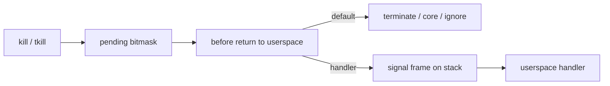
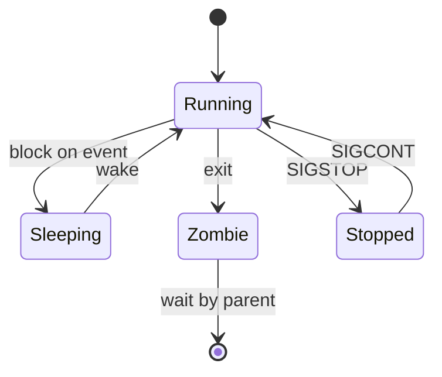

Signals are asynchronous messages to a task: terminate, stop, dump core, or run a handler.

## Delivery sketch

## Lifecycle reminder

## Keep reading

- `kernel/signal.c`
- Related: [Anatomy of a Linux process](/linternals/blog/anatomy-of-a-linux-process/)
