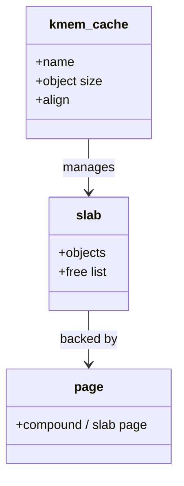

Userspace has `malloc`. Kernel code uses **`kmalloc`**, **`kmem_cache_alloc`**, and friends — usually backed by the **SLUB** slab allocator (historical SLAB/SLOB variants exist).

## Object caches



## Allocation paths


## Rules of thumb

- Prefer **typed caches** (`kmem_cache_create`) for hot structs.
- `kmalloc` rounds to size classes; huge sizes fall back toward the page allocator.
- Debugging: slab poisoning / redzoning when enabled; `/proc/slabinfo` (privileges vary).

## In the kernel

`kmalloc` in `include/linux/slab.h` is a macro. With allocation profiling it calls `kmalloc_noprof`, whose body is `__kmalloc_noprof` in `mm/slub.c`. The `_noprof` suffix is the profiling split, not a second allocator. Follow it into `__do_kmalloc_node`.

That function has two exits. If the size is above `KMALLOC_MAX_CACHE_SIZE`, it calls `__kmalloc_large_node_noprof` and the page allocator does the work. A zero size returns `ZERO_SIZE_PTR` and does not touch a slab. Everything else calls `kmalloc_slab` to pick the size-class `kmem_cache` (`kmalloc-64`, `kmalloc-128`, and so on), then `slab_alloc_node` to take an object.

The fast path inside `slab_alloc_node` is `alloc_from_pcs`. That pops one object from a per-CPU sheaf (`slub_percpu_sheaves`) and returns. An empty sheaf falls through `__slab_alloc_node` into `___slab_alloc`, which refills from a slab page or asks the page allocator for a new one. Typed objects skip the size-class lookup. `kmem_cache_alloc_noprof` goes straight to `slab_alloc_node` on the cache the caller created.

Freeing is the reverse. The usual path is `free_to_pcs`, which puts the object back on the per-CPU sheaf. An empty slab page can go back to the page allocator. `kfree` on a large allocation frees pages, not a slab object.

## Source landmarks

| Piece | Where |
| --- | --- |
| Macro | `include/linux/slab.h` — `kmalloc` |
| Size split | `mm/slub.c` — `__do_kmalloc_node` |
| Object pop | `mm/slub.c` — `slab_alloc_node`, `alloc_from_pcs`, `___slab_alloc` |
| Typed cache | `mm/slub.c` — `kmem_cache_alloc_noprof` |

## Lab — Peek at slabs

<div class="lab">

### Lab — slabinfo (if permitted)

```bash
# May require root:
sudo head -20 /proc/slabinfo 2>/dev/null || echo 'no slabinfo access'
# kmalloc size classes often visible as kmalloc-* names
sudo grep '^kmalloc-' /proc/slabinfo 2>/dev/null | head
```

**Expect:** lines with object sizes and active/object counts, or a permission message.

</div>

<div class="lab">

### Lab — See the size split

**Goal:** Find where a small `kmalloc` stops being a slab object.

1. Open `include/linux/slab.h` and find the `kmalloc` macro. Note that it calls a `noprof` helper when allocation profiling is on.
2. Open `mm/slub.c` and find `__do_kmalloc_node`. The `KMALLOC_MAX_CACHE_SIZE` test is the page-allocator fallback.
3. Find `slab_alloc_node`. The hit path should call `alloc_from_pcs`. The miss path goes through `__slab_alloc_node` to `___slab_alloc`.

**Expect:** one function decides “slab object” versus “whole pages”. The per-CPU sheaf pop is a different function from the page refill.

</div>

## Keep reading

- [Virtual memory walkthrough](/linternals/blog/virtual-memory-walkthrough/)
- [Memory reclaim and OOM](/linternals/blog/memory-reclaim-and-oom/)
- [Page cache and writeback](/linternals/blog/page-cache-and-writeback/)
