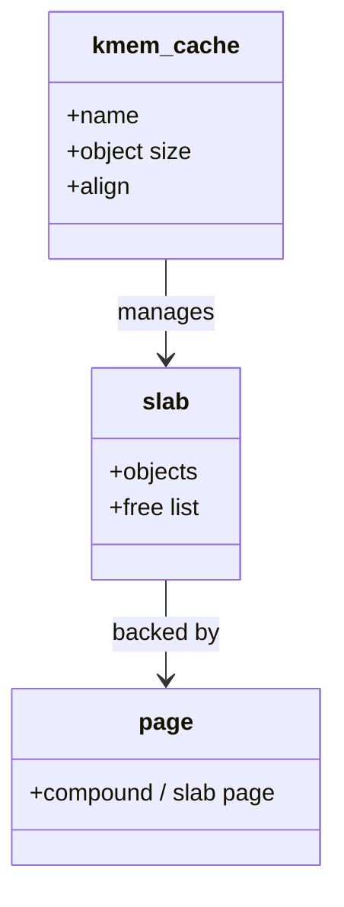
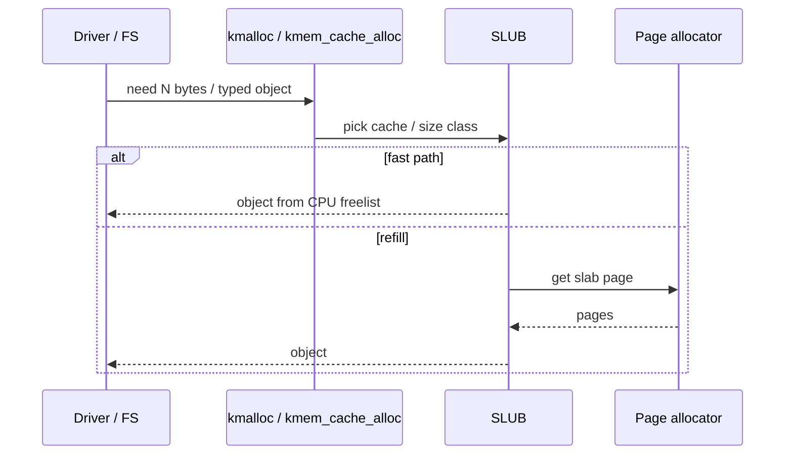

Userspace has `malloc`. Kernel code uses **`kmalloc`**, **`kmem_cache_alloc`**, and friends — usually backed by the **SLUB** slab allocator (historical SLAB/SLOB variants exist).

## Object caches



## Allocation paths



## Rules of thumb

- Prefer **typed caches** (`kmem_cache_create`) for hot structs.
- `kmalloc` rounds to size classes; huge sizes fall back toward page allocator.
- Debugging: slab poisoning / redzoning when enabled; `/proc/slabinfo` (privileges vary).

## Source landmarks

| Piece | Where |
| --- | --- |
| SLUB | `mm/slub.c` |
| kmalloc | `mm/slab_common.c`, headers |
| Docs | `Documentation/mm/` |

## Lab — Peek at slabs

<div class="lab">

### Lab — slabinfo (if permitted)

```bash
# May require root:
sudo head -20 /proc/slabinfo 2>/dev/null || echo 'no slabinfo access'
# kmalloc size classes often visible as kmalloc-* names
sudo grep '^kmalloc-' /proc/slabinfo 2>/dev/null | head
```

**Expect:** lines with object sizes and active/object counts, or a permission message.

</div>

## Keep reading

- [Virtual memory walkthrough](/linternals/blog/virtual-memory-walkthrough/)
- [Memory reclaim and OOM](/linternals/blog/memory-reclaim-and-oom/)
- [Page cache and writeback](/linternals/blog/page-cache-and-writeback/)
