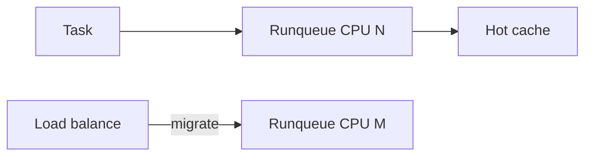
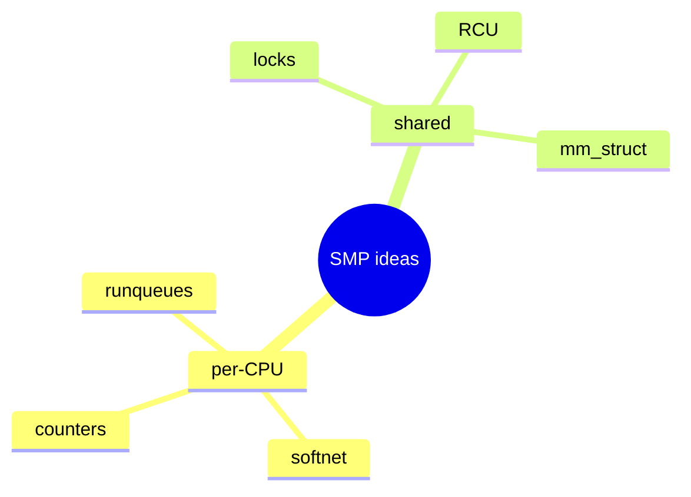

Linux scales with **SMP**: many CPUs, shared memory, careful synchronization. Schedulers migrate tasks for load balance; sometimes you **pin** work to keep cache hot.

## Per-CPU vs shared





## Affinity knobs

| Interface | Role |
| --- | --- |
| `sched_setaffinity` | Pin a thread’s CPU set |
| cpuset cgroup | Hierarchical CPU allow lists |
| IRQ affinity | `/proc/irq/N/smp_affinity` |
| `taskset` | Userspace helper |

Pinning can reduce jitter; over-pinning can leave CPUs idle. Measure.

## In the kernel

Each CPU has its own runqueue. A task runs where `task_cpu(p)` says it currently is. Load balance tries to move work when one CPU is busy and another is idle. In the fair class that entry is `sched_balance_rq` in `kernel/sched/fair.c`: it walks the scheduling domains, finds a busier group, and migrates tasks onto the local runqueue.

Userspace pinning goes through `sched_setaffinity` in `kernel/sched/syscalls.c`. After permission checks it builds an `affinity_context` and calls `__sched_setaffinity`, which intersects the requested mask with the cpuset-allowed CPUs, then `__set_cpus_allowed_ptr` in `kernel/sched/core.c`. That updates `p->cpus_mask`. If the task is running on a CPU outside the new mask, the migration stopper path (`migration_cpu_stop` / `stop_one_cpu_nowait`) moves it onto an allowed CPU.

Kernel code that needs to restrict a task without the syscall uses `set_cpus_allowed_ptr` directly; it is the same `__set_cpus_allowed_ptr` underneath. IRQ affinity is separate: it lives under `/proc/irq/N/smp_affinity` and the IRQ subsystem, not the task’s `cpus_mask`.

So affinity is a mask on the `task_struct`. Load balance is the ongoing mover. The stopper is the forced migrate when the mask no longer includes the current CPU.

## Source landmarks

| Piece | Where |
| --- | --- |
| Syscall | `kernel/sched/syscalls.c` — `sched_setaffinity`, `__sched_setaffinity` |
| Apply mask | `kernel/sched/core.c` — `set_cpus_allowed_ptr`, `__set_cpus_allowed_ptr` |
| Forced migrate | `kernel/sched/core.c` — `migration_cpu_stop` |
| Load balance | `kernel/sched/fair.c` — `sched_balance_rq` |

## Lab — See your affinity

<div class="lab">

### Lab — taskset / status

```bash
# CPUs allowed for this shell
taskset -p $$ 2>/dev/null || grep Cpus_allowed_list /proc/$$/status
nproc
```

**Expect:** a CPU list mask and the online processor count.

</div>

<div class="lab">

### Lab — Mask then migrate

**Goal:** Separate the affinity update from the load-balance scan.

1. Open `sched_setaffinity` in `kernel/sched/syscalls.c`. Follow it to `__set_cpus_allowed_ptr`.
2. In `kernel/sched/core.c`, find `set_cpus_allowed_ptr` and a call site that uses `stop_one_cpu_nowait` with `migration_cpu_stop`.
3. Find `sched_balance_rq` in `kernel/sched/fair.c`. That is periodic / idle balancing, not the affinity syscall.

**Expect:** changing the mask and pulling tasks for load are different functions. Affinity can force a migrate immediately when the current CPU is disallowed.

</div>

## Keep reading

- [Scheduler: CFS and EEVDF](/linternals/blog/scheduler-cfs-and-eevdf/)
- [cgroup v2 controllers](/linternals/blog/cgroup-v2-controllers/)
- [Locks: spinlocks, mutexes, RCU](/linternals/blog/locks-spinlocks-mutexes-rcu/)
