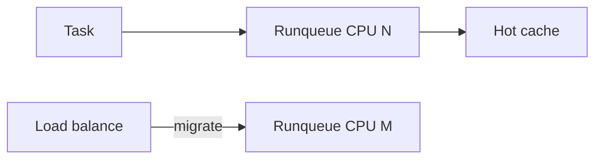
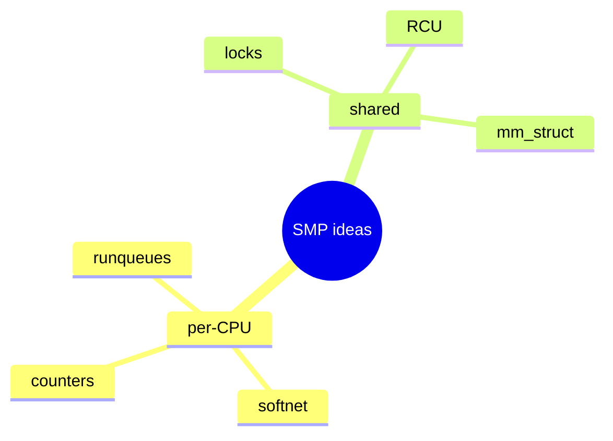

Linux scales with **SMP**: many CPUs, shared memory, careful synchronization. Schedulers migrate tasks for load balance; sometimes you **pin** work to keep cache hot.

## Per-CPU vs shared





## Affinity knobs

| Interface | Role |
| --- | --- |
| `sched_setaffinity` | Pin a thread’s CPU set |
| cpuset cgroup | Hierarchical CPU allow lists |
| IRQ affinity | `/proc/irq/N/smp_affinity` |
| `taskset` | Userspace helper |

Pinning can reduce jitter; over-pinning can leave CPUs idle. Measure.

## Source landmarks

| Piece | Where |
| --- | --- |
| Scheduler | `kernel/sched/` |
| Affinity | `kernel/sched/core.c` |
| Docs | `man 2 sched_setaffinity` |

## Lab — See your affinity

<div class="lab">

### Lab — taskset / status

```bash
# CPUs allowed for this shell
taskset -p $$ 2>/dev/null || grep Cpus_allowed_list /proc/$$/status
nproc
```

**Expect:** a CPU list mask and the online processor count.

</div>

## Keep reading

- [Scheduler: CFS and EEVDF](/linternals/blog/scheduler-cfs-and-eevdf/)
- [cgroup v2 controllers](/linternals/blog/cgroup-v2-controllers/)
- [Locks: spinlocks, mutexes, RCU](/linternals/blog/locks-spinlocks-mutexes-rcu/)
