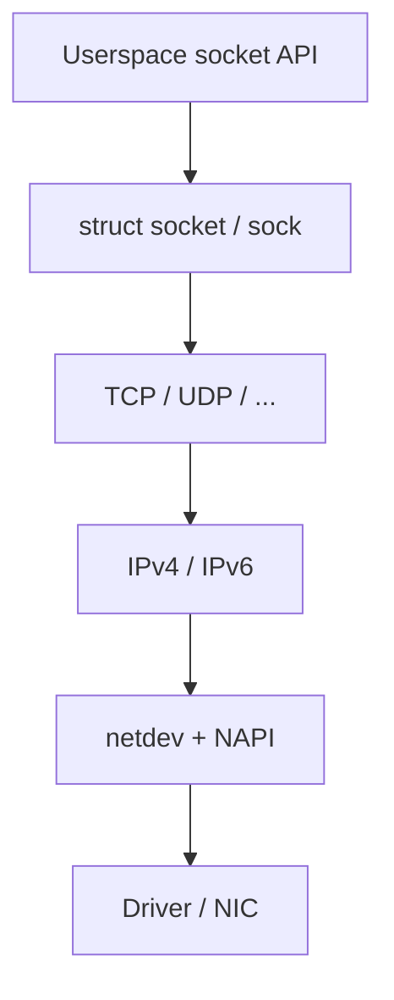

Networking in Linux is layered: sockets for apps, protocols in `net/`, and drivers that push frames to hardware.

## Layers

## Packet carrier: sk_buff

Almost every packet is an `sk_buff` (skb): headers, payload references, and metadata that travel up and down the stack.

## Source landmarks

- `net/socket.c` — syscall side
- `net/ipv4/` — IPv4 / TCP
- `include/linux/skbuff.h` — skb

## Keep reading

- [AF_UNIX sockets](/linternals/blog/af-unix-sockets/)
- [TCP state machine sketch](/linternals/blog/tcp-state-machine-sketch/)
- [NAPI and softnet](/linternals/blog/napi-and-softnet/)
- [epoll and event loops](/linternals/blog/epoll-and-event-loops/)
- [kernel.org — networking docs](https://docs.kernel.org/networking/)
- Related: [Syscalls: crossing the boundary](/linternals/blog/syscalls-crossing-the-boundary/)
