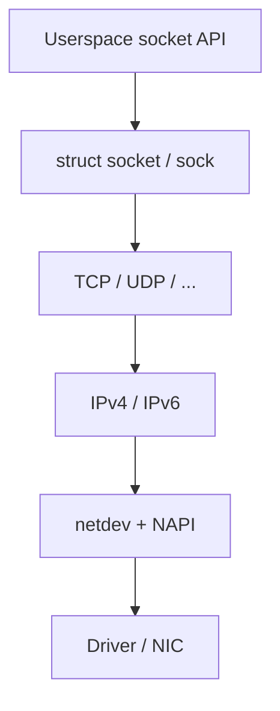
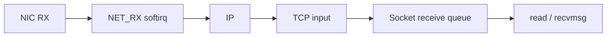

Networking in Linux is layered: the **socket API** for applications, protocol implementations under `net/`, and drivers that move frames through hardware. Understanding one vertical slice — “send a TCP byte” or “receive a UDP datagram” — unlocks most of the rest.

## Layers



Userspace sees an `fd`. Inside the kernel that fd refers to a `struct socket` wrapping a protocol-specific `struct sock` (`tcp_sock`, …). Syscalls like `sendmsg` / `recvmsg` land in `net/socket.c` and dispatch through protocol operation tables.

## In the kernel

`socket()` is `SYSCALL_DEFINE3(socket` in `net/socket.c`. It calls `__sys_socket`, which calls `__sys_socket_create` and then `sock_map_fd`. Creation is where `AF_INET` versus `AF_UNIX` is chosen: the family picks a `struct net_proto_family`, that allocates a `struct socket`, and the protocol attaches `sock->ops` and `sock->sk`. The fd is just an index to that socket, same as any other file.

A later `sendmsg` reaches `__sock_sendmsg`. The first thing that function does is `security_socket_sendmsg` (the LSM hook). If that allows the call, `sock_sendmsg_nosec` performs an indirect call through `sock->ops->sendmsg`. For IPv4 that is `inet_sendmsg`, which copies the payload into an `sk_buff` and hands it to TCP or UDP. The socket layer does not build an Ethernet header.

Receive comes from the other end. A NAPI poll builds an skb and eventually calls `netif_receive_skb` in `net/core/dev.c`. The comment there says it is the main receive data processing function, and it may only be used in a context that can run softirq work. It calls `netif_receive_skb_internal` → `__netif_receive_skb` → `__netif_receive_skb_core`, which walks packet types (IP, ARP, …) and delivers to the protocol. The matching socket is found by the protocol, not by `netif_receive_skb` itself. `recvmsg` then copies from that socket’s receive queue.

`struct sk_buff` is defined in `include/linux/skbuff.h`. Header pointers (`mac_header`, `network_header`, `transport_header`) are offsets into the same buffer so each layer can push or pull without copying the payload.

## Outbound sketch (TCP)

1. App calls `send` / `write` / `sendmsg`.
2. Kernel copies (or zero-copies) data into socket send buffers — subject to `SO_SNDBUF` and congestion window.
3. TCP builds segments, attaches headers, hands `sk_buff`s to IP.
4. IP routes, sets L3 headers, passes to the egress `net_device`.
5. Driver DMA-maps buffers and rings the NIC doorbell.
6. Completions free or recycle skbs later (NAPI / TX reclaim).

Local delivery (same host) short-circuits through the stack without a physical NIC — still using skbs and softirqs.

## Inbound sketch



1. NIC DMAs a frame; hard IRQ schedules **NAPI**.
2. Softirq / NAPI builds or fills an `sk_buff`, may run GRO.
3. Protocol demux (ethertype → IP → L4 port / tuple).
4. Packet lands on a socket receive queue; sleeping receivers wake; `epoll` sees readability.

Details of TCP states: [TCP state machine sketch](/linternals/blog/tcp-state-machine-sketch/). Driver RX: [NAPI and softnet](/linternals/blog/napi-and-softnet/).

## Packet carrier: sk_buff

Almost every packet is an **`sk_buff` (skb)**: linear data and/or page fragments, header offsets, checksum state, and metadata (device, skb mark, clone flags). Cloning and sharing matter for performance — and for bugs when a layer mutates a shared skb incorrectly.

Filters and policy hit the path via **netfilter** hooks ([Netfilter hooks sketch](/linternals/blog/netfilter-and-hooks-sketch/)) and eBPF programs on tc/XDP/cgroup attachments.

## Not everything is TCP/IP

- **UDP** — datagrams, simpler queues, still skbs.
- **AF_UNIX** — local IPC with the socket API ([AF_UNIX sockets](/linternals/blog/af-unix-sockets/)).
- **Raw / packet sockets** — observability and custom protocols; privileged.

## Source landmarks

| Piece | Where |
| --- | --- |
| Create | `net/socket.c` — `__sys_socket`, `sock_map_fd` |
| Send | `net/socket.c` — `__sock_sendmsg`, `sock->ops->sendmsg` |
| Receive | `net/core/dev.c` — `netif_receive_skb`, `__netif_receive_skb_core` |
| Packet | `include/linux/skbuff.h` |
| TCP | `net/ipv4/tcp_input.c`, `net/ipv4/tcp_output.c` |

## Lab — Watch sockets

<div class="lab">

### Lab — `ss` and a little structure

```bash
ss -tulpn | head -25
ss -ti | head -15
# Kernel tables (no process names):
head -5 /proc/net/tcp
```

**Expect:** listening and established sockets; `-ti` adds TCP internals (cwnd, rtt) when available; `/proc/net/tcp` shows hex addresses and state codes.

</div>

<div class="lab">

### Lab — Create and send are different files from receive

**Goal:** See the socket layer stop at `ops->sendmsg`.

1. Open `net/socket.c` and find `SYSCALL_DEFINE3(socket`. It should call `__sys_socket`.
2. Find `sock_sendmsg_nosec`. The call is `sock->ops->sendmsg`, not a direct call to `tcp_sendmsg`.
3. Open `net/core/dev.c` and find `netif_receive_skb`. Read the comment immediately above it.

**Expect:** TX enters through the socket ops. RX enters through `netif_receive_skb` from the driver / NAPI side. They meet only at the `struct sock` queues.

</div>

## Pitfalls

- **Buffer bloat vs drops** — huge `SO_RCVBUF` can hide backpressure; tiny buffers cause app-level retries.
- **Blocking vs edge-triggered epoll** — must drain until `EAGAIN` on ET ([epoll and event loops](/linternals/blog/epoll-and-event-loops/)).
- **Checksum offload** — skbs may defer checksums; capturing tools can look “wrong” until realized.
- **Namespaces** — each netns has its own interfaces and sockets ([Network namespaces and veth](/linternals/blog/netns-and-veth/)).

## Keep reading

- [AF_UNIX sockets](/linternals/blog/af-unix-sockets/)
- [TCP state machine sketch](/linternals/blog/tcp-state-machine-sketch/)
- [NAPI and softnet](/linternals/blog/napi-and-softnet/)
- [epoll and event loops](/linternals/blog/epoll-and-event-loops/)
- [Netfilter hooks sketch](/linternals/blog/netfilter-and-hooks-sketch/)
- [kernel.org — networking docs](https://docs.kernel.org/networking/)
- Related: [Syscalls: crossing the boundary](/linternals/blog/syscalls-crossing-the-boundary/)
