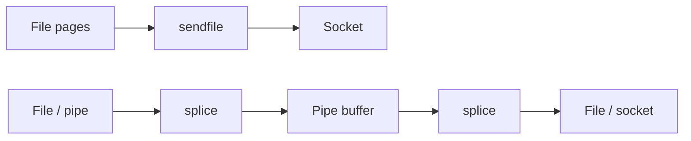

Copying file → socket via `read`/`write` touches userspace twice. **`sendfile`** and **`splice`** move pages through the kernel (often via the **pipe** buffer machinery) to cut copies.

## Paths



## Comparison

| Call | Typical use |
| --- | --- |
| `sendfile` | File → socket (HTTP static files) |
| `splice` | Between pipe and file/socket; more general |
| `copy_file_range` | File → file server-side copy |
| `io_uring` | Modern batched / registered buffers |

“Zero-copy” is aspirational — DMA, page cache, and protocol headers still impose constraints. Measure before celebrating.

## Source landmarks

| Piece | Where |
| --- | --- |
| splice | `fs/splice.c` |
| sendfile | arch/generic wrappers → splice |
| Man | `sendfile(2)`, `splice(2)` |

## Lab — Trace a sendfile server (optional)

<div class="lab">

### Lab — See the syscalls

```bash
# If you have a simple static file server handy, attach strace:
# strace -e sendfile,splice,read,write -p <pid>
# Or self-check man pages exist:
man 2 sendfile 2>/dev/null | head -12 || true
man 2 splice 2>/dev/null | head -12 || true
```

**Expect:** man pages describing in-kernel transfer; live traces show `sendfile`/`splice` on optimized servers.

</div>

## Keep reading

- [Page cache and writeback](/linternals/blog/page-cache-and-writeback/)
- [io_uring intro](/linternals/blog/io-uring-intro/)
- [Sockets and the networking stack](/linternals/blog/sockets-and-the-networking-stack/)
