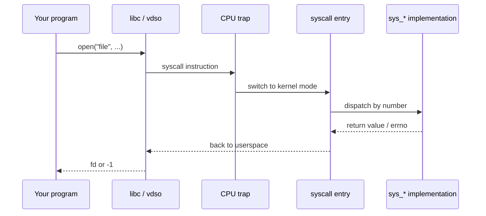
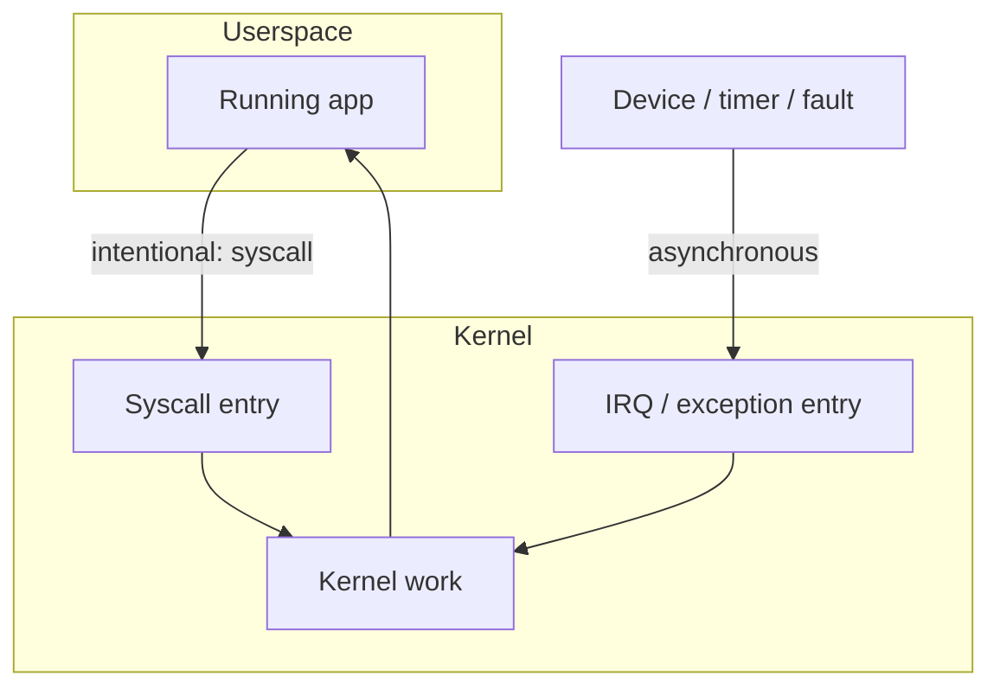

Almost everything interesting a program does — open a file, map memory, create a process — eventually becomes a **system call**. That is the supervised doorway between userspace and kernel.

## The call path



## Mental model

1. Your code calls a libc wrapper (`open`, `read`, `mmap`, …).
2. libc (or the vDSO for a few hot paths) issues the architecture’s syscall instruction (`syscall` on x86-64).
3. The CPU switches privilege level; the kernel lands in arch-specific entry code.
4. A **syscall number** indexes a table of handlers (`sys_openat`, …).
5. The handler runs with kernel privileges, then returns a value that libc maps to success or `errno`.

## Syscall vs hardware interrupt

Both enter the kernel, but for different reasons:



## Where to look in source

| Piece | Typical location |
| --- | --- |
| x86-64 entry | `arch/x86/entry/` |
| Syscall table | arch syscall tables / unistd |
| Implementations | `fs/open.c`, `mm/mmap.c`, `kernel/fork.c`, … |
| Man pages | section 2 (`man 2 open`) |

## Trace it live

```bash
# Watch syscalls of a command
strace -e trace=openat,read,write,mmap ls /

# Or with fewer distractions
strace -c ls /   # summary counts
```

## Why this matters for internals

Once you can name the syscall, you can grep the kernel for `SYSCALL_DEFINE` and read the real policy: permission checks, locking, and which subsystems get involved.

## Keep reading

- [man 2 syscalls](https://man7.org/linux/man-pages/man2/syscalls.2.html)
- Next: [Virtual memory walkthrough](/linternals/blog/virtual-memory-walkthrough/)
