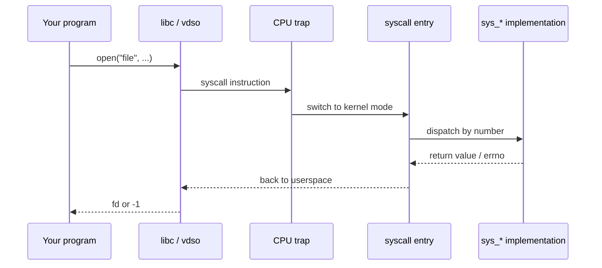
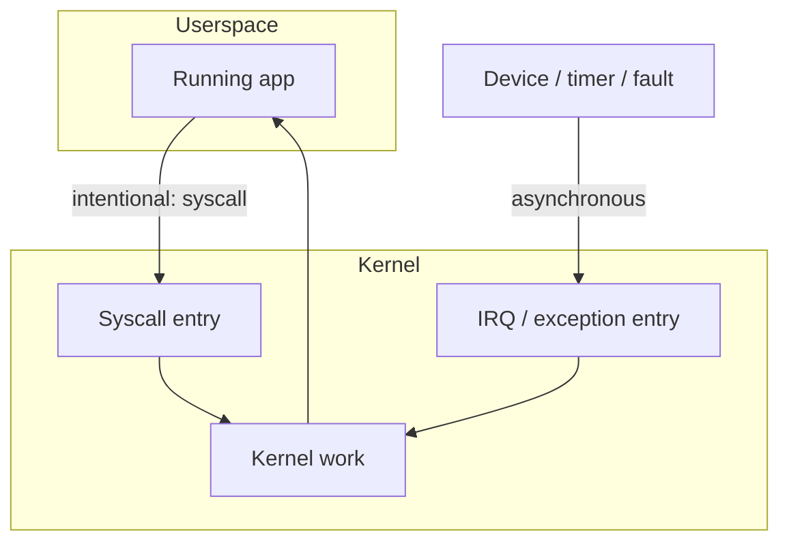

Almost everything interesting a program does — open a file, map memory, create a process — eventually becomes a **system call**. That is the supervised doorway between userspace and kernel.

## The call path



## Mental model

1. Your code calls a libc wrapper (`open`, `read`, `mmap`, …).
2. libc (or the vDSO for a few hot paths) issues the architecture’s syscall instruction (`syscall` on x86-64).
3. The CPU switches privilege level; the kernel lands in arch-specific entry code.
4. A **syscall number** indexes a table of handlers (`sys_openat`, …).
5. The handler runs with kernel privileges, then returns a value that libc maps to success or `errno`.

## In Linux 7.2.11 (x86-64)

The instruction is still `syscall`. What it lands on is `entry_SYSCALL_64` in `arch/x86/entry/entry_64.S`. That stub `swapgs`es, switches to the kernel stack and kernel CR3, builds a `struct pt_regs` (user `rsp`, `rflags`, `rip` from `rcx`, syscall number from `eax`), then `call do_syscall_64`.

`do_syscall_64` is a C function in `arch/x86/entry/syscall_64.c`. It runs `syscall_enter_from_user_mode` (which is where seccomp and ptrace can reject the call), then `do_syscall_x64`.

**The table is not the dispatcher anymore.** The comment above `sys_call_table[]` in that file says the array is no longer used to make the call; tracing still wants the addresses. The actual dispatch is `x64_sys_call()`, a `switch (nr)` whose cases are generated from `asm/syscalls_64.h`. Each case calls `__x64_<syscall>(regs)`. An out-of-range number becomes `__x64_sys_ni_syscall`. The return value is written to `regs->ax`.

Exit tries `SYSRET` when the register state is still the clean 64-bit shape `syscall` entry set up (`rcx == rip`, `r11 == flags`, user CS/SS). Anything dirtier — a signal frame, a changed segment, Xen PV — returns false from `do_syscall_64` and the assembly takes the slower `IRET` path.

So when you grep, search for `__x64_sys_openat` or `SYSCALL_DEFINE`, not for an indirect call through `sys_call_table` on this architecture.

## Syscall vs hardware interrupt

Both enter the kernel, but for different reasons:



## Where to look in source

| Piece | Typical location |
| --- | --- |
| x86-64 entry | `arch/x86/entry/` |
| Syscall table | arch syscall tables / unistd |
| Implementations | `fs/open.c`, `mm/mmap.c`, `kernel/fork.c`, … |
| Man pages | section 2 (`man 2 open`) |

## Trace it live

```bash
# Watch syscalls of a command
strace -e trace=openat,read,write,mmap ls /

# Or with fewer distractions
strace -c ls /   # summary counts
```

<div class="lab">

### Lab — Name the doorway

**Goal:** Turn a userspace action into a syscall name you can grep for.

1. Trace a simple `ls`:
   ```bash
   strace -e trace=openat,getdents64,close ls /tmp 2>&1 | head -40
   ```
2. Count syscalls for the same command:
   ```bash
   strace -c ls /tmp 2>&1 | tail -20
   ```
3. Pick one frequent call (often `openat` or `getdents64`) and note it for the [openat source walk](/linternals/blog/walking-openat-in-the-source/).

**Expect:** a short list of file-related syscalls and a summary table of counts.

</div>

<div class="lab">

### Lab — Follow one `syscall` instruction

**Goal:** See the 7.2.11 entry path, including the unused table.

1. Open `arch/x86/entry/entry_64.S` and find `entry_SYSCALL_64`. Confirm the `call do_syscall_64`.
2. Open `arch/x86/entry/syscall_64.c`. Read the comment on `sys_call_table` and the `switch` inside `x64_sys_call`.
3. Find `do_syscall_x64`. The in-range path assigns `regs->ax`.

**Expect:** dispatch is a switch on the syscall number, not a load from `sys_call_table`. The table still exists for tracing.

</div>

## Why this matters for internals

Once you can name the syscall, you can grep the kernel for `SYSCALL_DEFINE` and read the real policy: permission checks, locking, and which subsystems get involved.

## Keep reading

- [man 2 syscalls](https://man7.org/linux/man-pages/man2/syscalls.2.html)
- [vDSO and vsyscall](/linternals/blog/vdso-and-vsyscall/)
- [epoll and event loops](/linternals/blog/epoll-and-event-loops/)
- [io_uring intro](/linternals/blog/io-uring-intro/)
- Next: [Virtual memory walkthrough](/linternals/blog/virtual-memory-walkthrough/)
