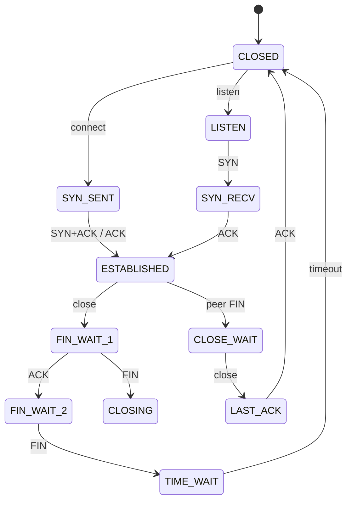
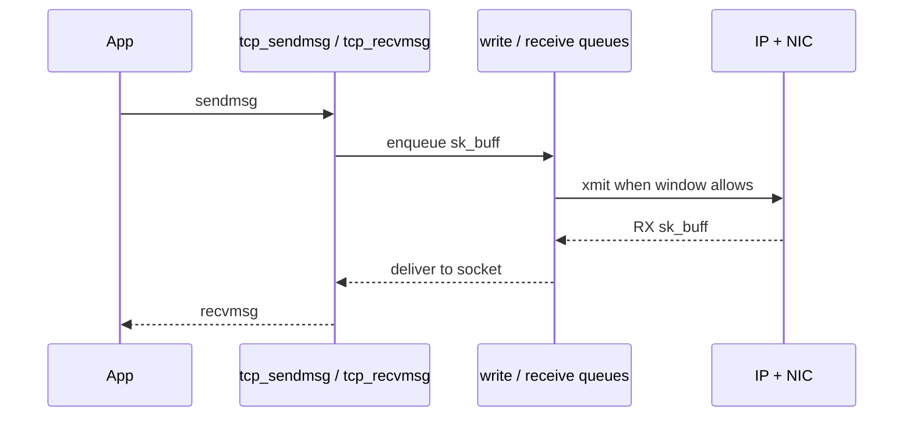

TCP is a **state machine** wrapped around reliable byte streams. The kernel keeps that machine in `struct sock` / `tcp_sock` and moves segments through `sk_buff` queues.

## High-level states



## Data path (established)



## Mental model

| Idea | Kernel reality |
| --- | --- |
| Connection | `struct sock` + TCP-specific fields |
| Segment | `sk_buff` on write/read/retransmit queues |
| Congestion / RTT | algorithms under `net/ipv4/` (and friends) |
| Observability | `ss -ti`, `/proc/net/tcp`, BPF |

You do not need every RFC edge case on day one. Learn **who owns the queues** and **which function names show up in traces**.

## Source landmarks

| Piece | Where |
| --- | --- |
| Core TCP | `net/ipv4/tcp*.c` |
| Output | `tcp_output.c` |
| Input | `tcp_input.c` |
| Docs | `Documentation/networking/` |

## Lab — Watch states

<div class="lab">

### Lab — `ss` state column

```bash
# Listening and established TCP
ss -tan | head -25
# Extra TCP info (cwnd, rtt, …) when supported
ss -ti sport = :22 | head -20
```

**Expect:** `LISTEN`, `ESTAB`, maybe `TIME-WAIT`. Extra lines show congestion / RTT fields when available.

</div>

## Keep reading

- [Sockets and the networking stack](/linternals/blog/sockets-and-the-networking-stack/)
- [AF_UNIX sockets](/linternals/blog/af-unix-sockets/)
- [Interrupts, softirqs, and tasklets](/linternals/blog/interrupts-softirqs-and-tasklets/)
---
