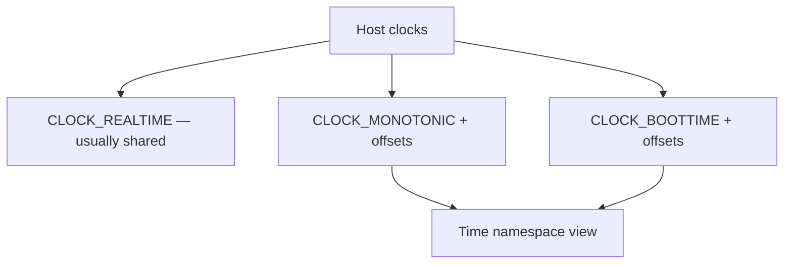
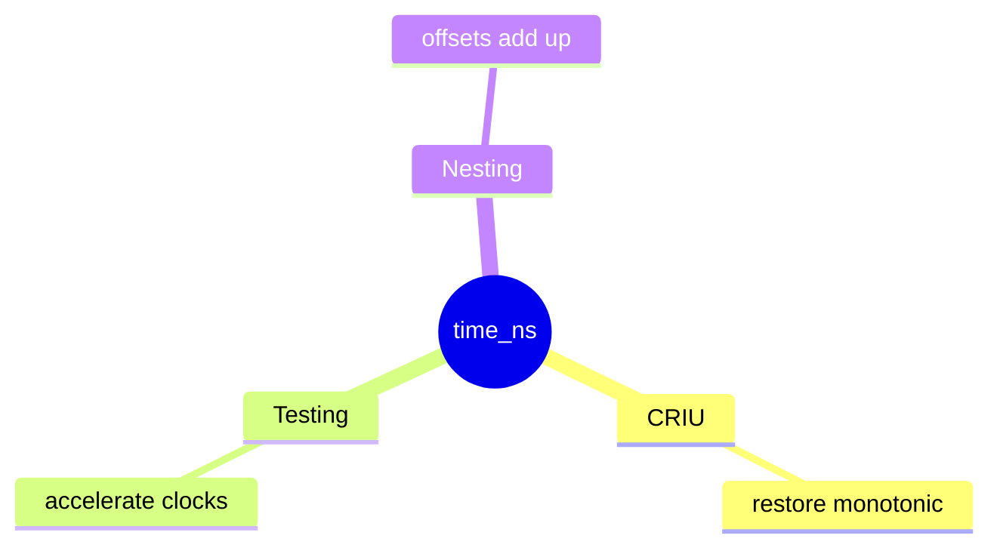

**Time namespaces** let a process tree see shifted **monotonic** and **boottime** clocks. Useful for checkpoint/restore and testing without lying about wall-clock `CLOCK_REALTIME` globally.

## What shifts



## Use cases



| Clock | Typical time-ns behavior |
| --- | --- |
| `CLOCK_REALTIME` | Not offset by time ns (settime rules elsewhere) |
| `CLOCK_MONOTONIC` | Offset per namespace |
| `CLOCK_BOOTTIME` | Offset per namespace |

Exact semantics follow `man 7 time_namespaces` — read before relying on them.

## Source landmarks

| Piece | Where |
| --- | --- |
| Core | `kernel/time/namespace.c` |
| Man | `time_namespaces(7)` |
| Related | [Timers and timekeeping](/linternals/blog/timers-and-timekeeping/) |

## Lab — Check support

<div class="lab">

### Lab — time ns inode

```bash
ls -l /proc/$$/ns/time 2>/dev/null || echo "time ns not in this kernel/userspace"
man 7 time_namespaces 2>/dev/null | head -15 || true
```

**Expect:** a `time:[…]` ns symlink on kernels with `CONFIG_TIME_NS`.

</div>

## Keep reading

- [Namespaces and cgroups](/linternals/blog/namespaces-and-cgroups/)
- [Timers and timekeeping](/linternals/blog/timers-and-timekeeping/)
- [vDSO and vsyscall](/linternals/blog/vdso-and-vsyscall/)
