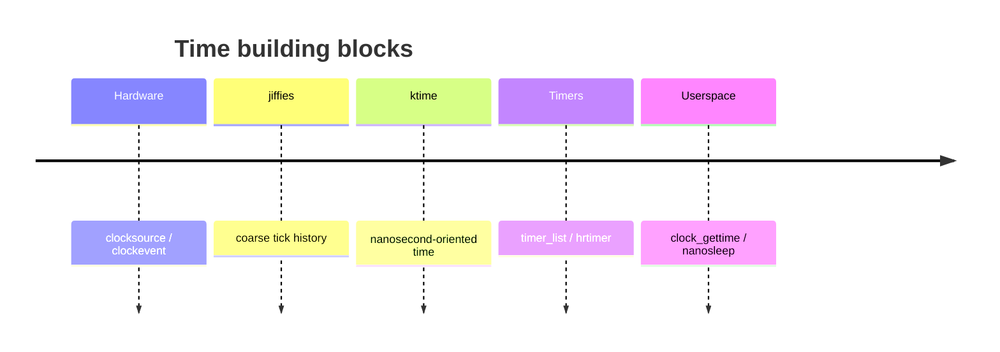
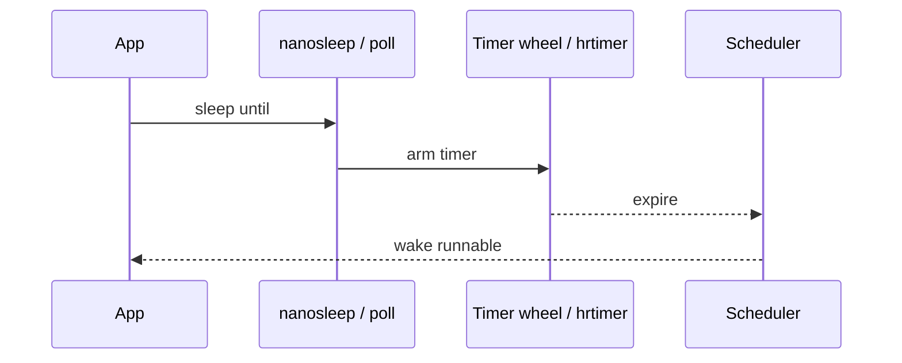

Scheduling, networking timeouts, and `sleep` all depend on the kernel’s **timekeeping** and **timer** subsystems.

## Two clocks in your head



## Arming a wakeup



## Ideas to keep straight

- **clocksource** — reads “what time is it?”
- **clockevent** — programs the next interrupt
- **timer_list** — classic tick-oriented timers
- **hrtimer** — high-res / ktime-based deadlines

## In the kernel

Reading time goes through the timekeeper in `kernel/time/timekeeping.c`. `ktime_get` takes a seqcount snapshot of the monotonic base, adds nanoseconds from the active clocksource (`timekeeping_get_ns`), and returns a `ktime_t`. Wall time and boot time are the same base plus offsets. The tick updates that state through `update_wall_time`.

Sleeping until a deadline is a timer, not a clock read. `nanosleep` in `kernel/time/hrtimer.c` converts the request to a `ktime_t` and calls `hrtimer_nanosleep`, which arms an `hrtimer_sleeper` and parks the task in `do_nanosleep`. The arm path is `hrtimer_start_range_ns`: it inserts the timer into a per-CPU red-black tree and reprograms the clockevent device for the next expiry.

When that interrupt fires, `hrtimer_interrupt` runs `__hrtimer_run_queues`, which walks expired timers and invokes their callbacks. For a nanosleep sleeper, the callback wakes the task. Classic `timer_list` / timer-wheel deadlines still exist for coarse kernel work; high-resolution sleeps and many networking timeouts use hrtimers.

So clocksource answers “what time is it?”, clockevent answers “interrupt me then”, and hrtimer is the software queue that connects a sleep to that interrupt.

## Source landmarks

| Piece | Where |
| --- | --- |
| Read time | `kernel/time/timekeeping.c` — `ktime_get`, `update_wall_time` |
| Sleep | `kernel/time/hrtimer.c` — `nanosleep`, `hrtimer_nanosleep`, `do_nanosleep` |
| Arm / expire | `kernel/time/hrtimer.c` — `hrtimer_start_range_ns`, `hrtimer_interrupt` |

## Lab — Ask the clocks

<div class="lab">

### Lab — Compare clocks

```bash
date +%s.%N
cat /proc/timer_list 2>/dev/null | head -5
# High-res availability hint:
grep -i hrtimer /proc/timer_list 2>/dev/null | head
python3 - <<'PY'
import time
print('monotonic', time.monotonic())
print('perf_counter', time.perf_counter())
PY
```

**Expect:** wall clock vs monotonic values that only move forward for `monotonic`.

</div>

<div class="lab">

### Lab — Read vs sleep

**Goal:** Separate timekeeping from the sleeper timer.

1. Open `ktime_get` in `kernel/time/timekeeping.c`. Note the seqcount loop around the clocksource read.
2. Open `nanosleep` in `kernel/time/hrtimer.c` and follow it into `hrtimer_nanosleep` / `do_nanosleep`.
3. Find `hrtimer_start_range_ns` and `hrtimer_interrupt`. Arm and expire are different ends of the same queue.

**Expect:** `ktime_get` never arms a sleeper. `nanosleep` never updates the wall clock.

</div>

## Keep reading

- [vDSO and vsyscall](/linternals/blog/vdso-and-vsyscall/)
- [Interrupts, softirqs, and bottom halves](/linternals/blog/interrupts-softirqs-and-tasklets/)
- [Scheduler: CFS and EEVDF](/linternals/blog/scheduler-cfs-and-eevdf/)
- [kernel.org — timers](https://docs.kernel.org/timers/)
