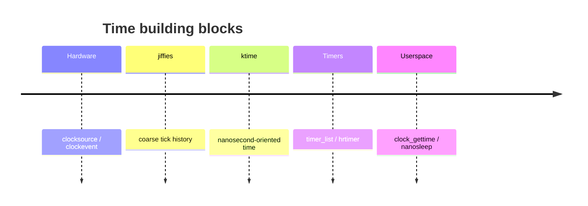
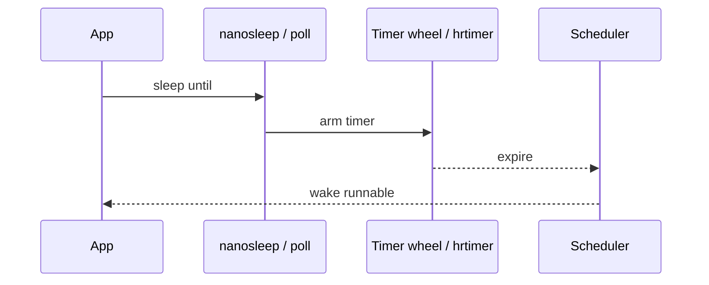

Scheduling, networking timeouts, and `sleep` all depend on the kernel’s **timekeeping** and **timer** subsystems.

## Two clocks in your head



## Arming a wakeup



## Ideas to keep straight

- **clocksource** — reads “what time is it?”
- **clockevent** — programs the next interrupt
- **timer_list** — classic tick-oriented timers
- **hrtimer** — high-res / ktime-based deadlines

## Source landmarks

| Piece | Where |
| --- | --- |
| Timekeeping | `kernel/time/timekeeping.c` |
| hrtimer | `kernel/time/hrtimer.c` |
| Docs | `Documentation/timers/` |

## Lab — Ask the clocks

<div class="lab">

### Lab — Compare clocks

```bash
date +%s.%N
cat /proc/timer_list 2>/dev/null | head -5
# High-res availability hint:
grep -i hrtimer /proc/timer_list 2>/dev/null | head
python3 - <<'PY'
import time
print('monotonic', time.monotonic())
print('perf_counter', time.perf_counter())
PY
```

**Expect:** wall clock vs monotonic values that only move forward for `monotonic`.

</div>

## Keep reading

- [vDSO and vsyscall](/linternals/blog/vdso-and-vsyscall/)
- [Interrupts, softirqs, and bottom halves](/linternals/blog/interrupts-softirqs-and-tasklets/)
- [Scheduler: CFS and EEVDF](/linternals/blog/scheduler-cfs-and-eevdf/)
- [kernel.org — timers](https://docs.kernel.org/timers/)
