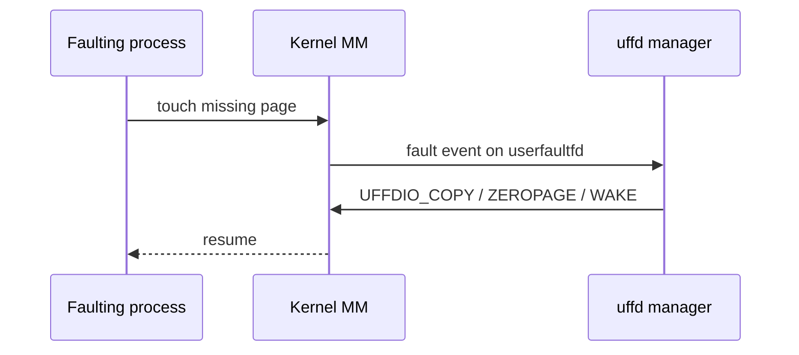
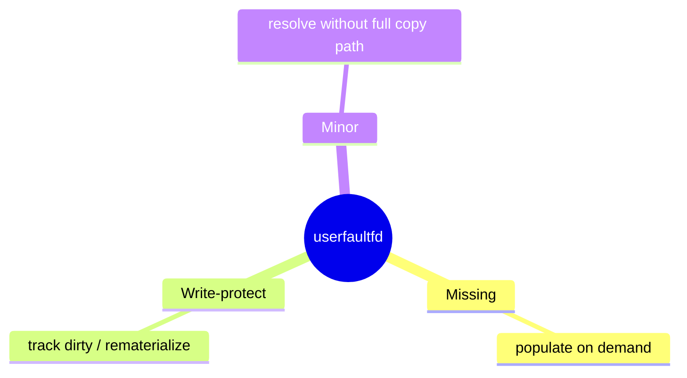

Normal faults are fixed in the kernel. **`userfaultfd`** lets a **manager process** resolve missing pages for another mapping — the foundation for live migration, lazy restore, and some snapshot schemes.

## Flow



## Modes (sketch)



Exact feature bits depend on kernel version (`UFFD_API`, ioctl ops). Treat man pages as the contract.

## Where it shows up

| Use | Idea |
| --- | --- |
| Live migration | Copy pages on demand from source |
| CRIU / restore | Lazy memory fill |
| Custom allocators | Delay backing until touch |

## Source landmarks

| Piece | Where |
| --- | --- |
| Core | `mm/userfaultfd.c` |
| UAPI | `include/uapi/linux/userfaultfd.h` |
| Man | `userfaultfd(2)`, `ioctl_userfaultfd(2)` |

## Lab — API presence

<div class="lab">

### Lab — Check userfaultfd headers

```bash
ls /usr/include/linux/userfaultfd.h 2>/dev/null || echo "headers not installed"
man 2 userfaultfd 2>/dev/null | head -20 || true
```

**Expect:** UAPI header and man page on a typical Linux -dev install.

</div>

## Keep reading

- [mmap and page faults (deep)](/linternals/blog/mmap-and-page-faults-deep/)
- [Page tables and the TLB](/linternals/blog/page-tables-and-tlb/)
- [Memory reclaim and OOM](/linternals/blog/memory-reclaim-and-oom/)
