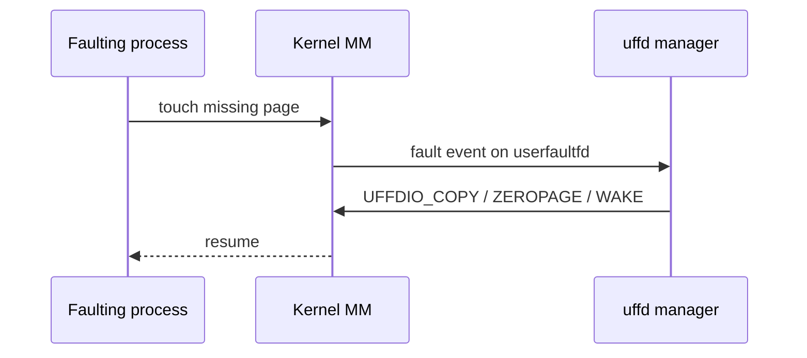
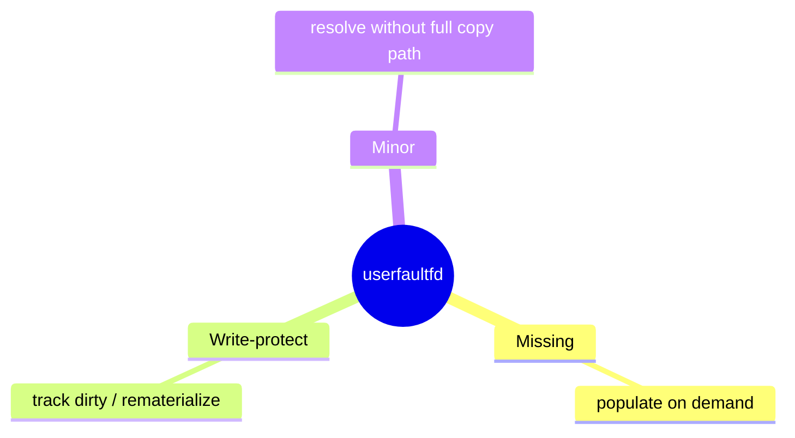

Normal faults are fixed in the kernel. **`userfaultfd`** lets a **manager process** resolve missing pages for another mapping — the foundation for live migration, lazy restore, and some snapshot schemes.

## Flow



## Modes (sketch)



Exact feature bits depend on kernel version (`UFFD_API`, ioctl ops). Treat man pages as the contract.

## In the kernel

`userfaultfd()` lands in `SYSCALL_DEFINE1(userfaultfd)` in `mm/userfaultfd.c` and creates a context through `new_userfaultfd`. The manager then registers ranges with `UFFDIO_REGISTER`, which reaches `userfaultfd_register` and attaches a `userfaultfd_ctx` to each VMA’s `vm_userfaultfd_ctx`.

A normal fault still enters `handle_mm_fault` in `mm/memory.c`. When that VMA is registered for missing or write-protect events, the fault path calls `handle_userfault` instead of allocating a folio itself. `handle_userfault` puts the faulting thread to sleep on the context’s wait queue and returns `VM_FAULT_RETRY`. The manager’s `poll`/`read` on the uffd wakes up with the fault address.

The manager fills memory with ioctls. `UFFDIO_COPY` reaches `userfaultfd_copy`, which calls `mfill_atomic_copy` to install pages into the faulting address space. `UFFDIO_ZEROPAGE` and `UFFDIO_WAKE` are the zero-fill and resume paths. After the copy, the sleeping faulting thread is woken and retries the access against a now-present PTE.

So the fault is still a page fault; the kernel only changes who supplies the folio. The faulting process waits. The manager writes. Then the fault retries.

## Where it shows up

| Use | Idea |
| --- | --- |
| Live migration | Copy pages on demand from source |
| CRIU / restore | Lazy memory fill |
| Custom allocators | Delay backing until touch |

## Source landmarks

| Piece | Where |
| --- | --- |
| Syscall | `mm/userfaultfd.c` — `userfaultfd`, `new_userfaultfd` |
| Fault divert | `mm/userfaultfd.c` — `handle_userfault` (called from `mm/memory.c`) |
| Fill | `mm/userfaultfd.c` — `userfaultfd_copy` → `mfill_atomic_copy` |
| UAPI | `include/uapi/linux/userfaultfd.h` |

## Lab — API presence

<div class="lab">

### Lab — Check userfaultfd headers

```bash
ls /usr/include/linux/userfaultfd.h 2>/dev/null || echo "headers not installed"
man 2 userfaultfd 2>/dev/null | head -20 || true
```

**Expect:** UAPI header and man page on a typical Linux -dev install.

</div>

<div class="lab">

### Lab — Find the divert

**Goal:** See that a registered VMA redirects the fault instead of allocating.

1. Open `mm/userfaultfd.c` and find `handle_userfault`. Note the `VM_FAULT_RETRY` return.
2. Search `mm/memory.c` for `handle_userfault`. Missing and write-protect sites both call it.
3. Find `userfaultfd_copy` and confirm it ends in `mfill_atomic_copy`.

**Expect:** fault divert and page install are two functions. The faulting thread sleeps between them.

</div>

## Keep reading

- [mmap and page faults (deep)](/linternals/blog/mmap-and-page-faults-deep/)
- [Page tables and the TLB](/linternals/blog/page-tables-and-tlb/)
- [Memory reclaim and OOM](/linternals/blog/memory-reclaim-and-oom/)
