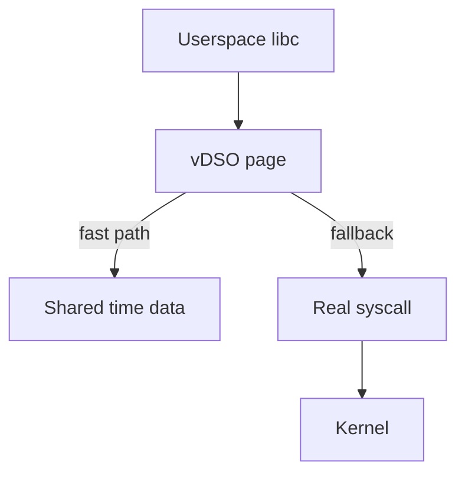
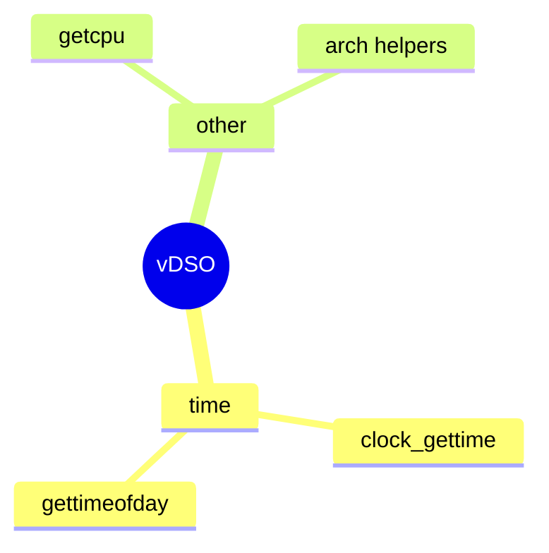

Not every “syscall” traps into the kernel. On modern Linux, hot paths like **clock_gettime** often run in the **vDSO** — a small shared object the kernel maps into every process.

## Layers



## vDSO vs vsyscall

| Mechanism | Idea |
| --- | --- |
| **vDSO** | ELF DSO at a randomized address; preferred |
| **vsyscall** | Fixed historical page; mostly compat / restricted |

Security hardening prefers vDSO; vsyscall may be emulated or disabled depending on config.

## What lives there



Exact symbols are arch- and libc-dependent (`linux-vdso.so.1` in `ldd`).

## Source landmarks

| Piece | Where |
| --- | --- |
| x86 | `arch/x86/entry/vdso/` |
| Generic | `lib/vdso/` |
| Docs | `Documentation/ABI/stable/vdso` (tree varies) |

## Lab — Find the mapping

<div class="lab">

### Lab — Locate linux-vdso

```bash
ldd /bin/true | grep -i vdso || true
grep -i vdso /proc/$$/maps
# Symbol peek (if available):
python3 - <<'PY'
import ctypes, ctypes.util
# Just show maps line count with vdso
print(open('/proc/self/maps').read().count('vdso'))
PY
```

**Expect:** a `[vdso]` line in `/proc/$$/maps` and often `linux-vdso.so.1` from `ldd`.

</div>

## Keep reading

- [Syscalls: crossing the boundary](/linternals/blog/syscalls-crossing-the-boundary/)
- [Timers and timekeeping](/linternals/blog/timers-and-timekeeping/)
- [ELF loading and dynamic linking](/linternals/blog/elf-loading-and-dynamic-linking/)
