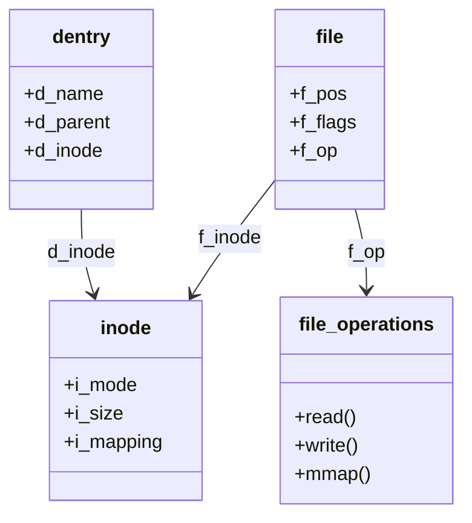
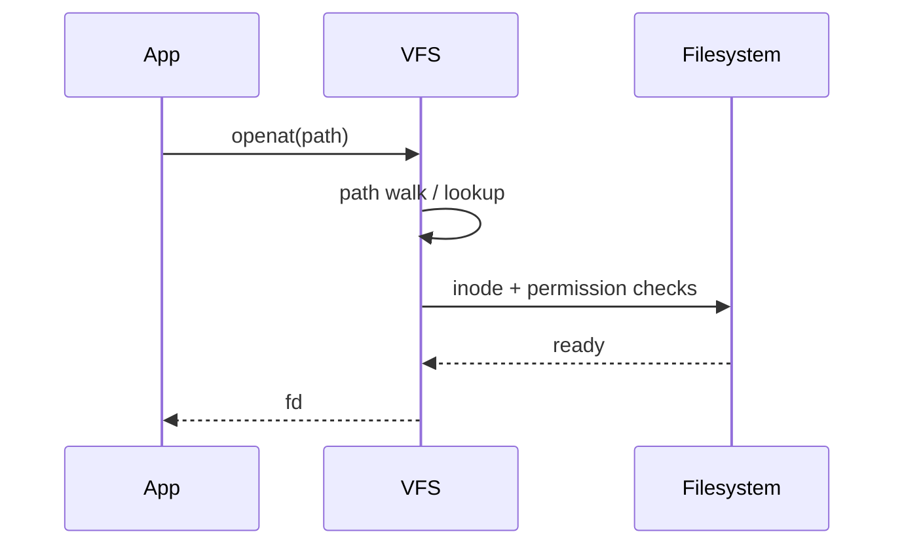

The Virtual File System is the kernel’s common front door. Whether the file lives on ext4, XFS, or procfs, userspace usually hits the same VFS objects first.

## Objects you meet



- **dentry** — cached path component → inode mapping
- **inode** — metadata and the object the FS understands
- **struct file** — per-open state (offset, flags, fops)

## Sketch of open



## In the kernel

`open` and `openat` are both `SYSCALL_DEFINE` wrappers in `fs/open.c`. They call `do_sys_open`, which fills a `struct open_how` and calls `do_sys_openat2`. That function builds `struct open_flags` and publishes the result with `FD_ADD(..., do_file_open(...))`. The returned number is the fd. A negative errno never becomes an installed descriptor.

`do_file_open` is in `fs/namei.c`. It sets up a `struct nameidata` (the walk cursor: directory fd, remaining path, current dentry) and calls `path_openat`. The first attempt uses `LOOKUP_RCU`, so the walk does not take the usual refcount locks. If that fails with `-ECHILD`, it retries without RCU. A stale dentry (`-ESTALE`) retries with `LOOKUP_REVAL`.

Inside `path_openat` the interesting loop is short:

1. `alloc_empty_file` creates the `struct file` before the walk finishes.
2. `link_path_walk` consumes every path component except the last.
3. `open_last_lookups` resolves the final component (create, truncate, or just find).
4. `do_open` checks permissions and calls the filesystem’s open method, which fills `f_op` and `f_inode`.

The filesystem does not see the path string. It sees a dentry and an inode that the walk already found. ext4, XFS, and procfs differ in how they implement lookup and `->open`, not in this loop.

## Source landmarks

| Piece | Where |
| --- | --- |
| Syscall | `fs/open.c` — `SYSCALL_DEFINE4(openat`, `do_sys_openat2` |
| Walk | `fs/namei.c` — `do_file_open`, `path_openat`, `link_path_walk` |
| Types | `include/linux/fs.h` — `struct file`, `struct inode` |
| Dentry | `include/linux/dcache.h` |

## Try this

```bash
# Which filesystem backs a path?
findmnt -T .
stat /
```

<div class="lab">

### Lab — Follow one open in the tree

**Goal:** See that the filesystem is not the first function `openat` calls.

1. Open `fs/open.c` and find `SYSCALL_DEFINE4(openat`. Confirm it calls `do_sys_open`.
2. Open `fs/namei.c` and find `do_file_open`. The first `path_openat` call passes `LOOKUP_RCU`.
3. In `path_openat`, find the `while` loop that calls `link_path_walk` and `open_last_lookups`.

**Expect:** current kernels call this `do_file_open`. Older trees used the name `do_filp_open` for the same step.

</div>

## Keep reading

- [ext4 on-disk sketch](/linternals/blog/ext4-on-disk-sketch/)
- [OverlayFS sketch](/linternals/blog/overlayfs-sketch/)
- [Block layer and bio](/linternals/blog/block-layer-and-bio/)
- [splice and sendfile](/linternals/blog/splice-and-sendfile/)
- [fcntl locks and leases](/linternals/blog/fcntl-locks-and-leases/)
- [io_uring intro](/linternals/blog/io-uring-intro/)
- [kernel.org — VFS](https://docs.kernel.org/filesystems/vfs.html)
- Next: [Sockets and the networking stack](/linternals/blog/sockets-and-the-networking-stack/)
