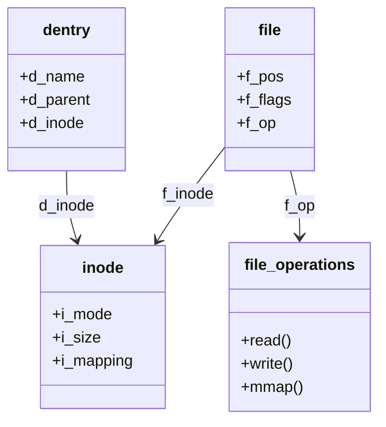
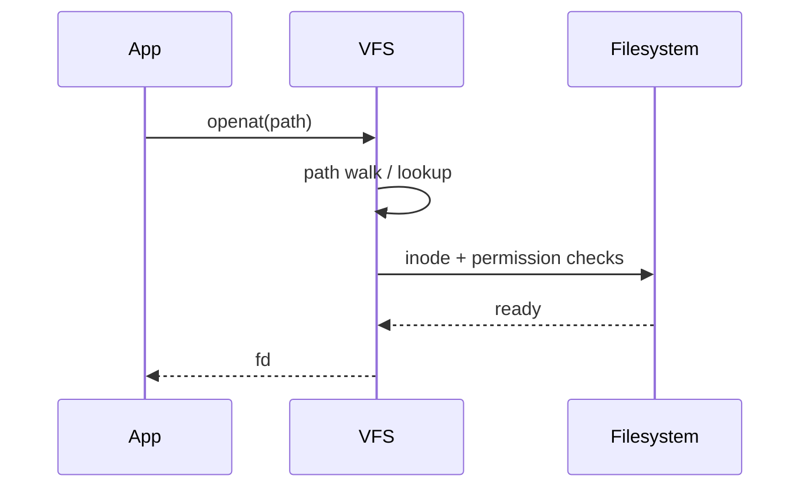

The Virtual File System is the kernel’s common front door. Whether the file lives on ext4, XFS, or procfs, userspace usually hits the same VFS objects first.

## Objects you meet



- **dentry** — cached path component → inode mapping
- **inode** — metadata and the object the FS understands
- **struct file** — per-open state (offset, flags, fops)

## Sketch of open



## Source landmarks

| Piece | Look here |
| --- | --- |
| Path walk | `fs/namei.c` |
| open family | `fs/open.c` |
| VFS types | `include/linux/fs.h` |

## Try this

```bash
# Which filesystem backs a path?
findmnt -T .
stat /
```

## Keep reading

- [kernel.org — VFS](https://docs.kernel.org/filesystems/vfs.html)
- Next: [Sockets and the networking stack](/linternals/blog/sockets-and-the-networking-stack/)
