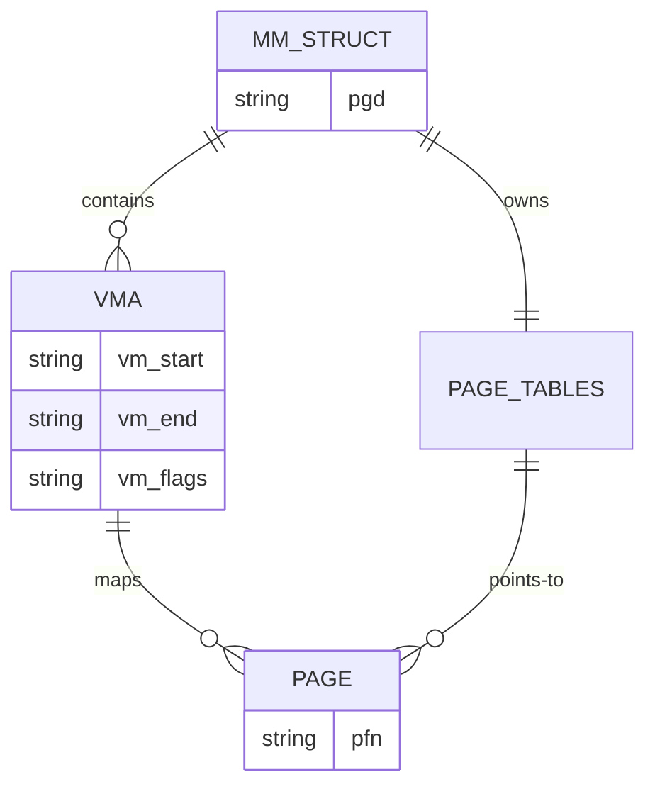
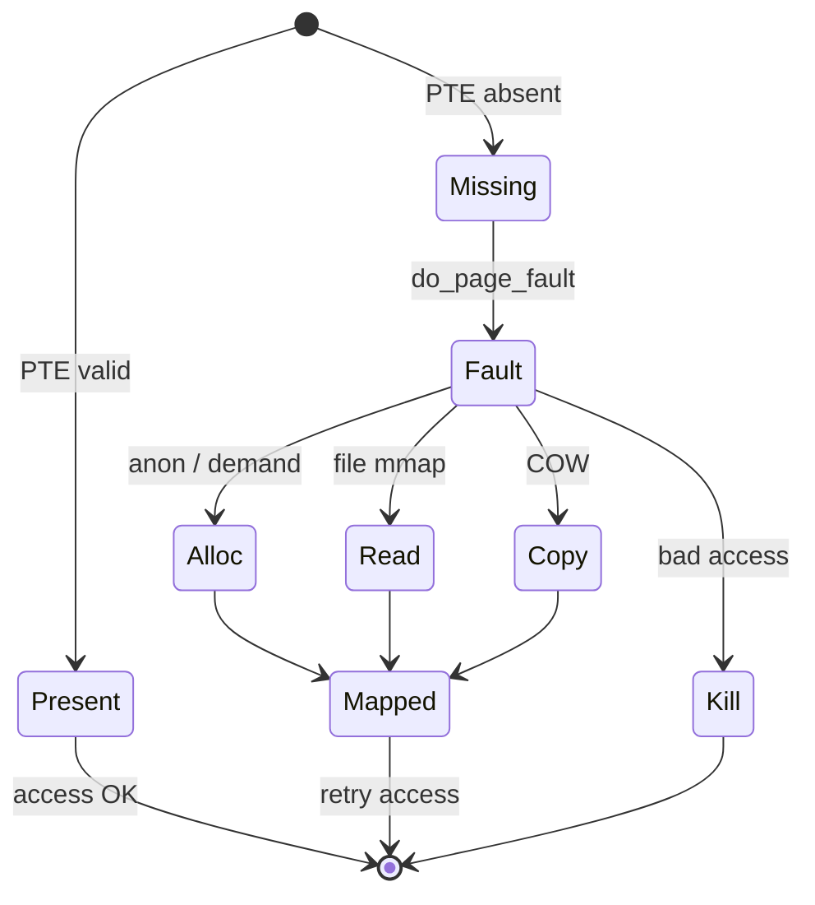

Every userspace pointer is **virtual**. The MMU and the kernel’s memory manager translate it to physical frames — or decide the access should fault.

## Layers



## Address space pieces

A process `mm_struct` tracks regions (`vm_area_struct` / VMAs): text, heap, stacks, `mmap` mappings, and so on.

## Page fault = opportunity

Faults are not only crashes. They implement:

- **demand paging** — load a page on first touch
- **copy-on-write** after `fork`
- **file-backed mmap** — bring file pages into RAM
- **stack growth** (within limits)



## Inspect your own map

```bash
# VMAs for the current shell
cat /proc/$$/maps | head

# Deeper: smaps has RSS / PSS per region
head -n 40 /proc/$$/smaps
```

<div class="lab">

### Lab — Read your own address space

**Goal:** Recognize text, heap, stack, and library mappings.

1. List maps for the current shell:
   ```bash
   cat /proc/$$/maps | head -30
   ```
2. Find the stack and libc (names vary by distro):
   ```bash
   grep -E '\[stack\]|libc' /proc/$$/maps | head
   ```
3. Compare RSS for a region via smaps:
   ```bash
   awk '/^[[:xdigit:]]/{p=$0} /Rss:/{print p,$0}' /proc/$$/smaps | head -15
   ```
**Expect:** executable mappings with `r-xp`, a `[stack]` line, and nonzero RSS on hot regions.

</div>

## Source landmarks

- `mm/memory.c` — fault handling core
- `mm/mmap.c` — creating and merging VMAs
- `include/linux/mm_types.h` — `mm_struct`, page types

## Keep reading

- [Slab allocator and kmalloc](/linternals/blog/slab-allocator-and-kmalloc/)
- [Page cache and writeback](/linternals/blog/page-cache-and-writeback/)
- [mmap and page faults (deep)](/linternals/blog/mmap-and-page-faults-deep/)
- [Memory reclaim and OOM](/linternals/blog/memory-reclaim-and-oom/)
- [kernel.org — Memory Management](https://docs.kernel.org/mm/index.html)
