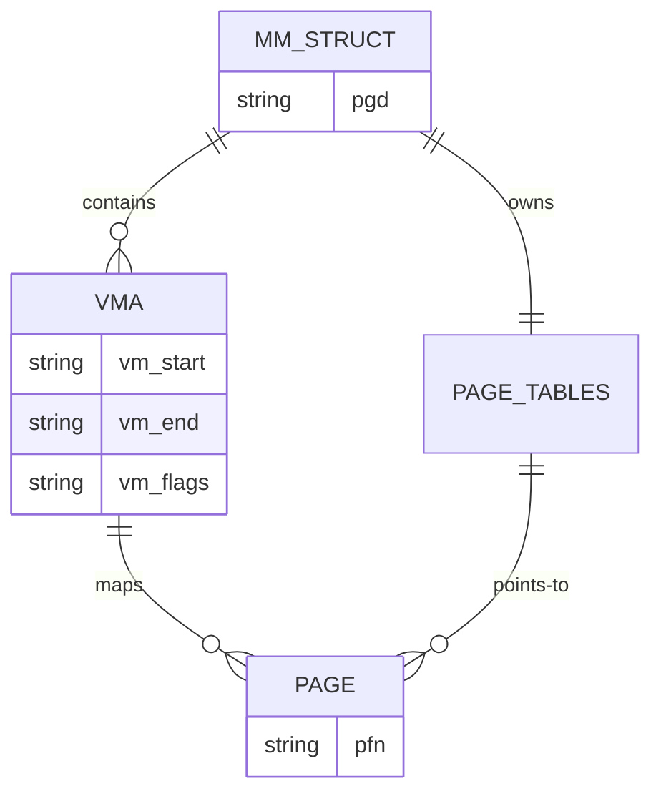
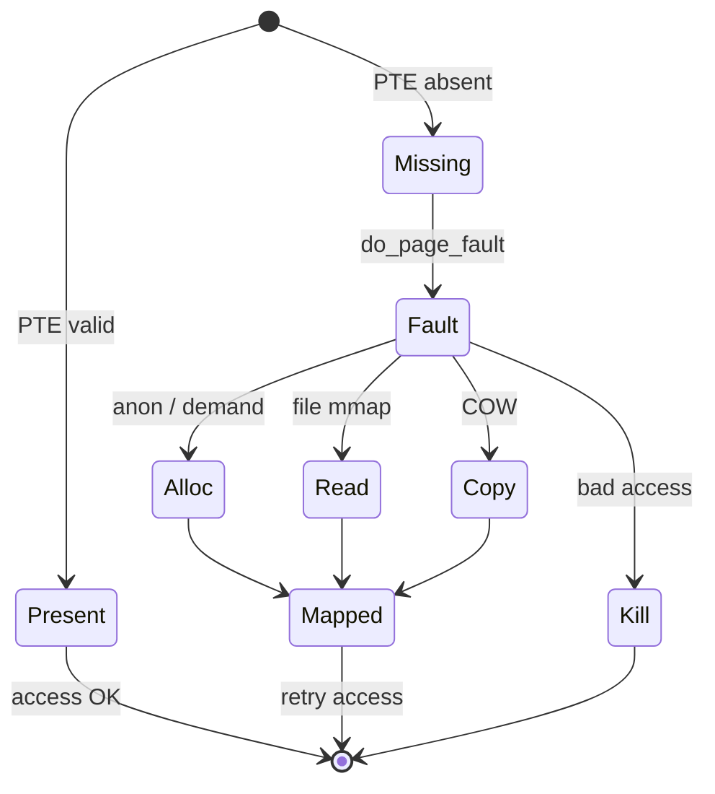

Every userspace pointer is **virtual**. The MMU and the kernel’s memory manager translate it to physical frames — or decide the access should fault.

## Layers



## Address space pieces

A process `mm_struct` tracks regions (`vm_area_struct` / VMAs): text, heap, stacks, `mmap` mappings, and so on.

## In Linux 7.2.11

The two structs live in `include/linux/mm_types.h`. `struct mm_struct` is the address space (`pgd`, the VMA tree, `mm_users`). `struct vm_area_struct` is one contiguous range: `vm_start` / `vm_end`, `vm_flags`, `vm_file` if the range is file-backed, and `vm_ops` for fault callbacks. A task reaches them through `task_struct.mm` (`include/linux/sched.h`). Kernel threads leave `mm` NULL.

A user access that misses in the page tables enters the arch fault handler and, if the address falls in a VMA, calls `handle_mm_fault()` in `mm/memory.c`. That function checks the VMA allows the access (`arch_vma_access_permitted`), then either `hugetlb_fault` or the normal path `__handle_mm_fault`. Anonymous first-touch ends in `do_anonymous_page`; file-backed faults go through `do_fault`. Copy-on-write is a write fault on a page that is still shared. A bad access returns `VM_FAULT_SIGSEGV` and the arch code raises `SIGSEGV` — the fault handler does not “crash” by itself.

`/proc/<pid>/maps` is a view of these VMAs, one line per `vm_area_struct`, not one line per page.

## Page fault = opportunity

Faults are not only crashes. They implement:

- **demand paging** — load a page on first touch
- **copy-on-write** after `fork`
- **file-backed mmap** — bring file pages into RAM
- **stack growth** (within limits)



## Inspect your own map

```bash
# VMAs for the current shell
cat /proc/$$/maps | head

# Deeper: smaps has RSS / PSS per region
head -n 40 /proc/$$/smaps
```

<div class="lab">

### Lab — Read your own address space

**Goal:** Recognize text, heap, stack, and library mappings.

1. List maps for the current shell:
   ```bash
   cat /proc/$$/maps | head -30
   ```
2. Find the stack and libc (names vary by distro):
   ```bash
   grep -E '\[stack\]|libc' /proc/$$/maps | head
   ```
3. Compare RSS for a region via smaps:
   ```bash
   awk '/^[[:xdigit:]]/{p=$0} /Rss:/{print p,$0}' /proc/$$/smaps | head -15
   ```
**Expect:** executable mappings with `r-xp`, a `[stack]` line, and nonzero RSS on hot regions.

</div>

<div class="lab">

### Lab — Name the fault entry

**Goal:** Connect a line in `/proc/self/maps` to a function.

1. Open `include/linux/mm_types.h` and find `struct vm_area_struct` and `struct mm_struct`.
2. Open `mm/memory.c` and find `handle_mm_fault`. Note the `VM_FAULT_SIGSEGV` return when the VMA forbids the access.
3. Search the same file for `do_anonymous_page` and `do_fault`.

**Expect:** one maps line is a VMA. The page is created later, inside `handle_mm_fault`, only if something touches an address in that range.

</div>

## Source landmarks

| Piece | Where in 7.2.11 |
| --- | --- |
| Structs | `include/linux/mm_types.h` — `mm_struct`, `vm_area_struct` |
| Faults | `mm/memory.c` — `handle_mm_fault`, `do_anonymous_page`, `do_fault` |
| Creating VMAs | `mm/mmap.c` |

## Keep reading

- [Page tables and the TLB](/linternals/blog/page-tables-and-tlb/)
- [Slab allocator and kmalloc](/linternals/blog/slab-allocator-and-kmalloc/)
- [Page cache and writeback](/linternals/blog/page-cache-and-writeback/)
- [mmap and page faults (deep)](/linternals/blog/mmap-and-page-faults-deep/)
- [Memory reclaim and OOM](/linternals/blog/memory-reclaim-and-oom/)
- [kernel.org — Memory Management](https://docs.kernel.org/mm/index.html)
