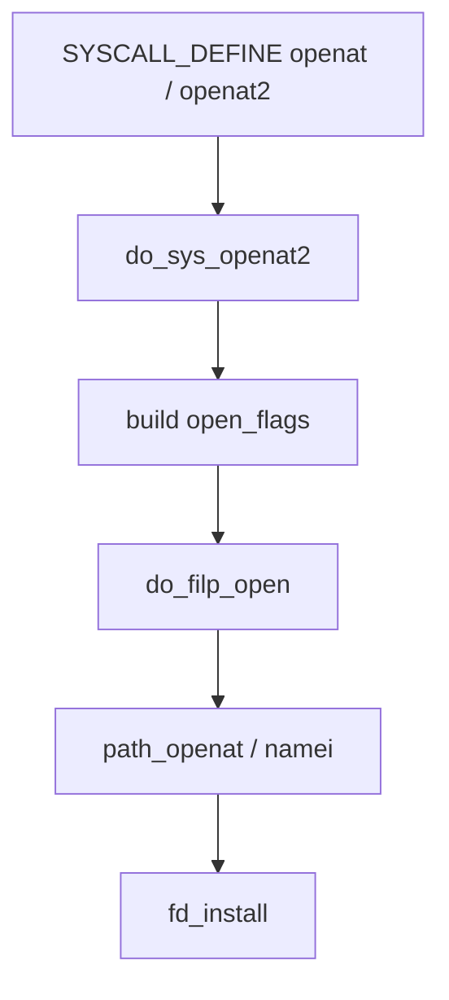
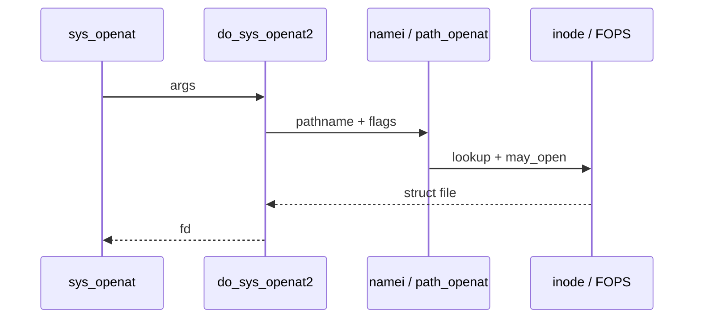

This note is a **reading script**, not a full annotated listing. Open a kernel tree (or [Elixir](https://elixir.bootlin.com/linux/latest/source)) and follow the stops in order.

## Why openat

`openat` is common in `strace` output and ties syscalls → VFS → filesystems together.



## Stops (≈45–60 minutes)

### 1. Find the syscall entry

Search for `SYSCALL_DEFINE` + `openat` (or `openat2`). Note arguments: `dfd`, `filename`, `flags`, `mode`.

**Ask:** which flags are validated early vs later?

### 2. Land in `do_sys_openat2`

Usually in `fs/open.c`. Skim:

- how `struct open_flags` is filled
- get unused fd / error paths
- call into `do_filp_open`

### 3. Path walk (`fs/namei.c`)

Follow into path lookup / `path_openat` territory:

- `LOOKUP_*` flags
- symlink handling (at a high level)
- final `vfs` permission checks



### 4. Return path

Confirm `fd_install` (or equivalent) publishes the `struct file` to the fd table before returning to userspace.

## Lab — Trace then grep

<div class="lab">

### Lab — From strace to symbol

1. Capture one open:
   ```bash
   strace -e openat ls /etc/hosts 2>&1 | head
   ```
2. In a kernel tree or Elixir, search `do_sys_openat2`.
3. Write five bullets: entry file, three callees, one error path you noticed.

</div>

## Keep reading

- [Syscalls: crossing the boundary](/linternals/blog/syscalls-crossing-the-boundary/)
- [VFS and the open path](/linternals/blog/vfs-and-the-open-path/)
- [Reading kernel source](/linternals/blog/reading-kernel-source/)
