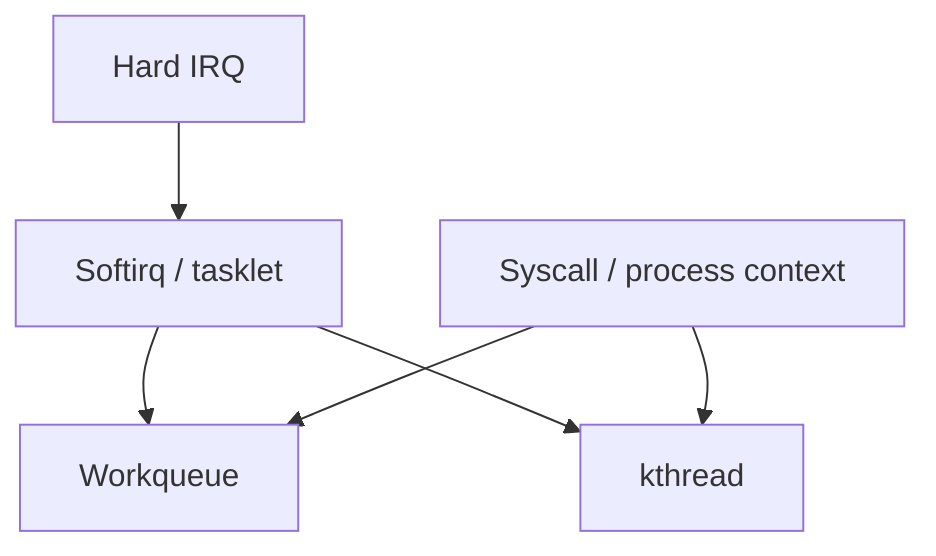
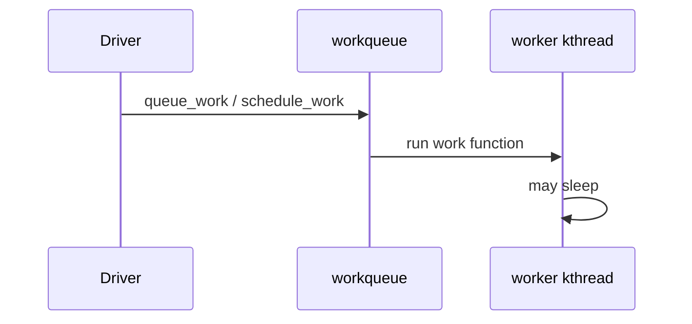

Hard IRQ context is tiny and non-sleepable. Much real driver and subsystem work lands on **workqueues** or **kernel threads** that can block, allocate, and take mutexes.

## Placement



## Workqueues



| API flavor | Idea |
| --- | --- |
| `schedule_work` | System-wide queue |
| `alloc_workqueue` | Dedicated queue / attributes |
| `queue_delayed_work` | Run after a delay |

Concurrency, CPU affinity, and reclaim behavior are tunable — start with the system queues unless you need isolation.

## kthreads

A **`kthread_create` / `kthread_run`** loop is a named kernel thread (`kworker`, `kswapd`, driver threads). Prefer workqueues for short deferred jobs; prefer a kthread when you need a long-lived event loop or custom scheduling.

## Source landmarks

| Piece | Where |
| --- | --- |
| Workqueues | `kernel/workqueue.c` |
| kthreads | `kernel/kthread.c` |
| Docs | `Documentation/core-api/workqueue.rst` |

## Lab — Spot workers

<div class="lab">

### Lab — List kernel threads

```bash
ps -eLo pid,tid,comm | grep -E 'kworker|kthread|kswapd' | head -25
# Or:
ls /proc/*/comm 2>/dev/null | head -5
ps -eo pid,comm | awk '$2 ~ /^\[/' | head -20
```

**Expect:** many `[kworker/*]` and other bracketed kernel threads.

</div>

## Keep reading

- [Interrupts, softirqs, and tasklets](/linternals/blog/interrupts-softirqs-and-tasklets/)
- [Locks: spinlocks, mutexes, RCU](/linternals/blog/locks-spinlocks-mutexes-rcu/)
- [Kernel modules and the device model](/linternals/blog/kernel-modules-and-device-model/)
