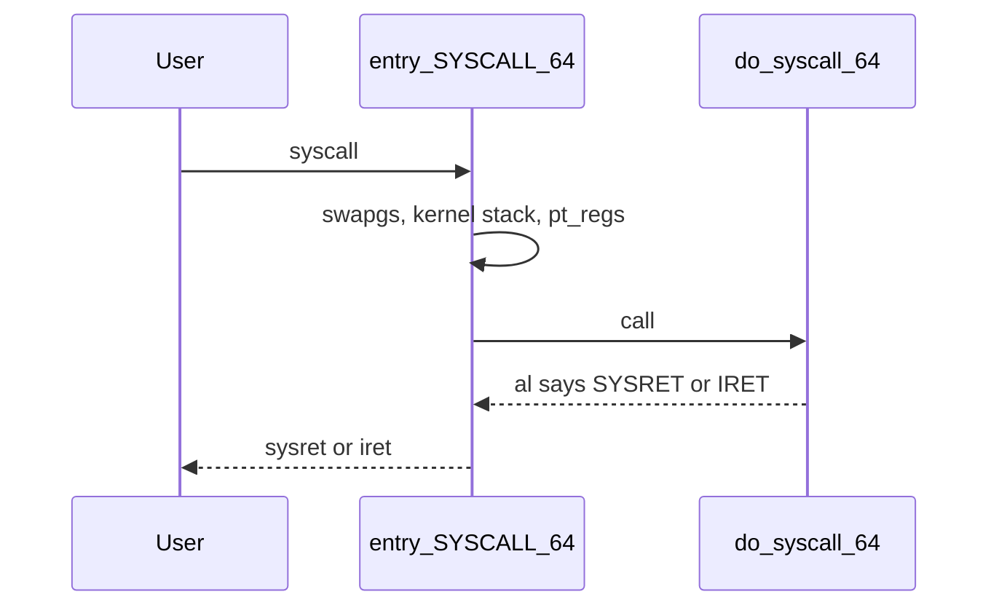

The [syscall note](/linternals/blog/syscalls-crossing-the-boundary/) follows a libc call into the kernel. This note is only the x86-64 landing: the instructions between the `syscall` opcode and `do_syscall_64`, and how the CPU gets back.

## Entry

`syscall` itself is a CPU instruction. Linux wires its target through MSRs at boot; the symbol you read is `entry_SYSCALL_64` in `arch/x86/entry/entry_64.S`.

The first instructions do four things, in order:

1. `swapgs` swaps the `gs` base so the kernel can reach per-CPU data. User `gs` is restored on the way out.
2. The user stack pointer is saved in `tss.sp2`, then `SWITCH_TO_KERNEL_CR3` loads the kernel page tables. This is the page-table isolation switch, not a context switch to another task.
3. `rsp` becomes `cpu_current_top_of_stack`. From here the CPU is on the kernel stack for this thread.
4. The stub pushes a `struct pt_regs`: user `ss`, the saved user `rsp`, `rflags` from `r11`, user `cs`, user `rip` from `rcx`, and the original `rax`. `PUSH_AND_CLEAR_REGS` stores the rest and clears them so user register values do not leak into the kernel. `eax` is sign-extended into `esi` as the syscall number. `rdi` is the `pt_regs` pointer.

Then `call do_syscall_64`. Interrupts are still off. The comment on that call says it returns with IRQs disabled.

## Dispatch, briefly

`do_syscall_64` lives in `arch/x86/entry/syscall_64.c`, not in the assembly file. It calls `syscall_enter_from_user_mode` (seccomp, ptrace, tracing) and then `do_syscall_x64`, which calls `x64_sys_call`. That function is a `switch` generated from `asm/syscalls_64.h`. `sys_call_table` in the same file is explicitly not used to make the call; tracing still wants the addresses. The handler writes its result to `regs->ax`.

## Return: SYSRET or IRET

`do_syscall_64` returns true when the register state is still a clean 64-bit user context: `rcx == rip`, `r11 == flags`, and CS/SS are the user values `MSR_STAR` expects. The assembly tests `%al`. False, or Xen PV, jumps to `swapgs_restore_regs_and_return_to_usermode`, which takes `IRET`. True falls through to `syscall_return_via_sysret`.

`SYSRET` is the fast path. It restores a fixed user CS/SS and returns to `rcx`. It cannot express a signal frame, a changed segment, or a non-canonical address, which is why the slow path exists. Before `SYSRET`, the stub switches back to the user CR3 from the trampoline stack and erases the leftover kernel stack (`STACKLEAK_ERASE_NOCLOBBER`).

## Source landmarks

| Piece | Where in 7.2.11 |
| --- | --- |
| Entry stub | `arch/x86/entry/entry_64.S` — `entry_SYSCALL_64`, `syscall_return_via_sysret` |
| Dispatch | `arch/x86/entry/syscall_64.c` — `do_syscall_64`, `x64_sys_call` |
| Why not the table | comment above `sys_call_table` in `syscall_64.c` |

## Lab — Read the stub, not the handler

### Lab — From `swapgs` to the call

**Goal:** Separate the CPU entry from the C dispatcher.

1. Open `arch/x86/entry/entry_64.S` and find `entry_SYSCALL_64`. Count the pushes that build `pt_regs` before `call do_syscall_64`.
2. Find `syscall_return_via_sysret` and the `jz` that sends failures to `swapgs_restore_regs_and_return_to_usermode`.
3. Open `arch/x86/entry/syscall_64.c` and read the comment on `sys_call_table`. Confirm `x64_sys_call` is a `switch`.

**Expect:** the assembly never mentions `open` or `read`. It only builds a register frame and calls one C function. The syscall number is `eax` on the way in and the return value is `rax` on the way out.

## Keep reading

- [Syscalls: crossing the boundary](/linternals/blog/syscalls-crossing-the-boundary/)
- [vDSO and vsyscall](/linternals/blog/vdso-and-vsyscall/)
- [Page tables and the TLB](/linternals/blog/page-tables-and-tlb/)
